# solo-lab

[](docs/SETUP.md#requirements)
[](docs/ENTERPRISE.md)
[](https://github.com/nickgamb/solo-lab/actions/workflows/ci.yaml)
[](LICENSE)

**An identity fabric built with [Solo.io](https://www.solo.io): every IdP a firm owns, through one
gateway, to every agent, tool, SaaS and model it uses.**

A production-shaped lab that runs on a laptop. People and agents sign in once.
agentgateway routes each sign-in to the right IdP, fails over between IdPs
without anything downstream noticing, checks the user and the workload on
every request, and mints each tool or SaaS a token for that call alone.

**kagent** traces every agent run down to the tool it called.

[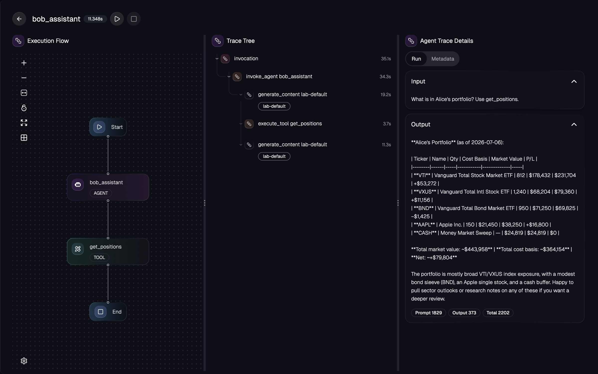](docs/images/solo-ui-kagent-trace.jpg)

**agentgateway** sees every call, model token and tool request.

[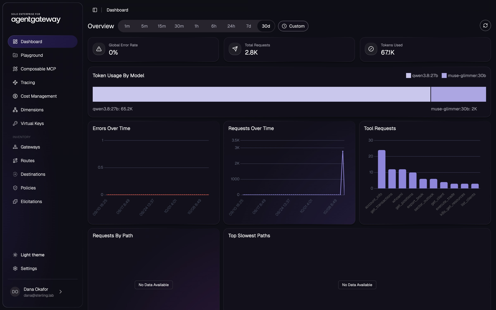](docs/images/solo-ui-agentgateway-dashboard.jpg)

**Istio ambient** maps the mesh, with live traffic between parties.

[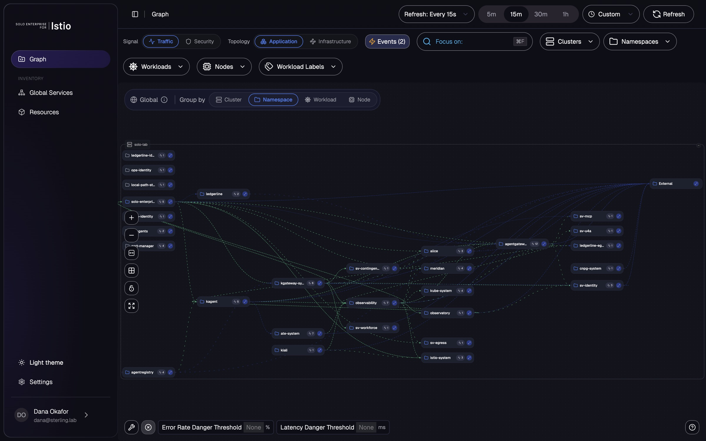](docs/images/solo-ui-mesh-graph.jpg)

**The Observatory**, the lab's own view, draws the identity fabric: agents and
apps through agentgateway to every IdP the firm owns, in failover order.

[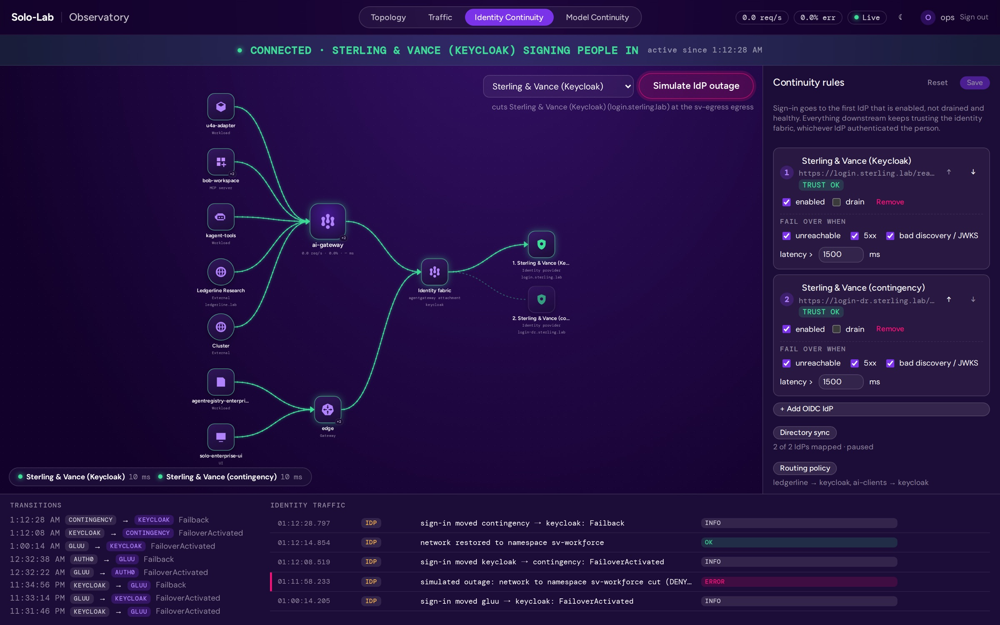](docs/images/observatory-continuity-connected.jpg)

## What it shows

| Story | What happens | Card |
| --- | --- | --- |
| Sign-in routing | Rules in CEL at the gateway send each sign-in to the right IdP, and fall back when it is down. | [identity fabric](docs/cards/identity-fabric.html) |
| IdP failover | Cut the active IdP off the network and sign-in moves to the next. The issuer and user stay the same, so nothing downstream changes. | [identity continuity](docs/cards/identity-continuity.html) |
| Assurance rules | Each workload sets the NIST 800-63B assurance level (AAL1 to AAL3) a sign-in must prove, enforced at the gateway by OPA: one Rego module in Solo's ext-auth service. After failover to an IdP that proves less, its requests are refused with an RFC 9470 step-up. | [assurance](docs/cards/assurance.html) |
| Relationships | OpenFGA decides which clients an advisor's agent may see, checked at the gateway on every tool call. The model and relationships are Kubernetes resources; group membership comes from the token. | [bob](docs/cards/bob.html) |
| Agents acting for people | Bob's agent never holds a token an MCP server accepts. The gateway mints one per call, enforces per-tool policy, and reaches a SaaS with Cross App Access (ID-JAG). | [bob](docs/cards/bob.html) |
| A client's data, on her terms | The same agent asks Alice. She approves each new tier and can deny a trade ([UMA for agents](https://u4a.ai)). | [bob to alice](docs/cards/bob-to-alice.html) |
| Models | Provider failover, prompt guards, masking, budgets and per-call cost, at the same gateway. | [Model Continuity](docs/OBSERVATORY.md#model-continuity) |
| Lateral movement | Agentshield maps the cluster (workloads, identities, mesh and gateway policy), watches the waypoints' traffic, and flags new paths with evidence; its investigations go to a model through the AI gateway. | [AGENTSHIELD.md](docs/AGENTSHIELD.md) |
| Datadog | Optional, one API key: the lab's traces, model calls, metrics and logs in Datadog APM, LLM Observability, Metrics and Logs, over OpenTelemetry. | [DATADOG.md](docs/DATADOG.md) |

Each card is a two-screen demo script. Open it in a browser (`open docs/cards/<card>.html`).

## Architecture

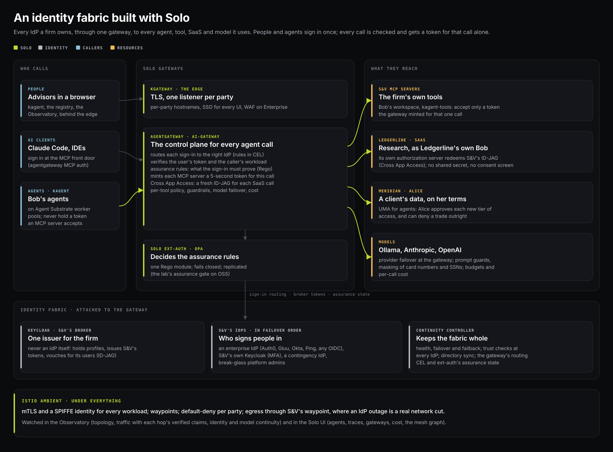

| Product | In this lab |
| --- | --- |
| [agentgateway](https://www.solo.io/products/agentgateway) | the firm's AI gateway: sign-in routing, the front door for every MCP server, a short-lived token per call, Cross App Access, models; Meridian's gateway |
| [kgateway](https://www.solo.io/products/kgateway) | the edge: TLS, one listener per party, SSO for every UI |
| [kagent + kmcp](https://www.solo.io/products/kagent) | agents, their controller and UI; MCP servers as Kubernetes resources |
| [Agent Substrate](https://www.solo.io/products/kagent) | every agent runs in a snapshot-backed sandbox on a worker pool |
| [agentregistry](https://www.solo.io/products/agentregistry) | the firm's catalog of agents, MCP servers and skills |
| [Istio ambient](https://www.solo.io/products/istio) | mTLS and a SPIFFE identity for every workload, waypoints, default-deny per party |
| [Agentshield](https://agent-shield.dev) | the platform team's view of lateral movement: the cluster's graph, the waypoints' traffic, findings with evidence |

Four parties share the platform: an advisory firm, its SaaS vendor, a client
and her brokerage. Each has its own namespaces, identities, IdP and
hostnames, and they meet only at the edge. Every product runs OSS by default
and switches to Solo Enterprise on its own ([ENTERPRISE.md](docs/ENTERPRISE.md)).
More in [ARCHITECTURE.md](docs/ARCHITECTURE.md).

## Quick start

You need Docker with 24 GB or more, kind, kubectl, helm, jq, yq and a model
(Ollama on the host, or an Anthropic or OpenAI key). The full list for each
OS is in [SETUP.md](docs/SETUP.md#requirements).

```bash
git clone https://github.com/nickgamb/solo-lab && cd solo-lab
cp .env.example .env      # optional: model provider, keys, IdPs, Solo Enterprise, Datadog
make machine-setup        # once per machine, sudo: *.lab DNS and the lab CA
make up                   # cluster, platform and every demo: ~30 min cold, ~17 GB
make status               # pods, the active IdP, URLs and sign-ins
```

Then open the Observatory at https://observatory.ops.lab (`ops` / `ops-demo`)
and run every check:

```bash
make verify               # rewinds the demos, then every enforcement check
```

`make down` deletes the cluster and keeps the image caches and the CA, so the
next `make up` is much faster; `make nuke` removes those too.

The same lab runs on one EC2 instance under public names with `make aws-up`
([AWS.md](docs/AWS.md)).

## What you can open

| URL | What | Sign in |
| --- | --- | --- |
| https://observatory.ops.lab | **Observatory**: topology, traffic with each hop's verified claims, identity and model continuity | `ops` / `ops-demo` |
| https://kagent.sterling.lab/ke/ | **Solo UI · kagent** (Enterprise): agents, chats, traces, tools, models. On OSS, https://kagent.sterling.lab is kagent's own UI | `bob` / `bob-demo` or `dana` / `dana-demo` |
| https://kagent.sterling.lab/age/ | **Solo UI · agentgateway** (Enterprise): gateways, routes, policies, traces, cost, playground | `dana` / `dana-demo` |
| https://kagent.sterling.lab/ie/graph | **Solo UI · Istio** (Enterprise): the mesh graph, global services, resources | `dana` / `dana-demo` |
| https://registry.sterling.lab | **agentregistry**: the firm's catalog, and the kagent runtime | `bob` / `bob-demo` |
| https://portal.alice.lab | Alice's portal: her grants and terms | `alice` / `alice-demo` |
| https://agentshield.ops.lab | **Agentshield**: the cluster's graph, findings with evidence, drafted rules | `ops` / `ops-demo` |
| https://grafana.ops.lab, https://kiali.ops.lab | Grafana; the Kiali mesh graph (view-only) | `ops` / `ops-demo` |
| https://idp.sterling.lab/realms/sterling-vance/account | S&V's broker: your account, signed in through the active IdP | `bob` / `bob-demo` |
| https://mcp.sterling.lab/mcp/bob-workspace | the firm's MCP front door for AI clients (Claude Code, an IDE): add it as a remote MCP server | `bob` / `bob-demo` |
| https://llm.sterling.lab/v1 | the firm's model route: OpenAI chat completions or Anthropic messages | API key `LLM_API_KEY` in `.lab/secrets.env` |

`bob` and `dana` sign in at S&V's active IdP, which asks for a one-time code
too: `make totp` for Bob, `make totp EMPLOYEE=dana` for Dana. That IdP is S&V's
own Keycloak unless you add an enterprise IdP such as Auth0 in `.env`, where
the passwords are your own. Every account is in
[SETUP.md](docs/SETUP.md#accounts); the APIs on the edge are in
[COMMANDS.md](docs/COMMANDS.md).

## See it

More of the Solo UI ([every section](docs/ENTERPRISE.md#the-solo-ui)):

| | |
| --- | --- |
| 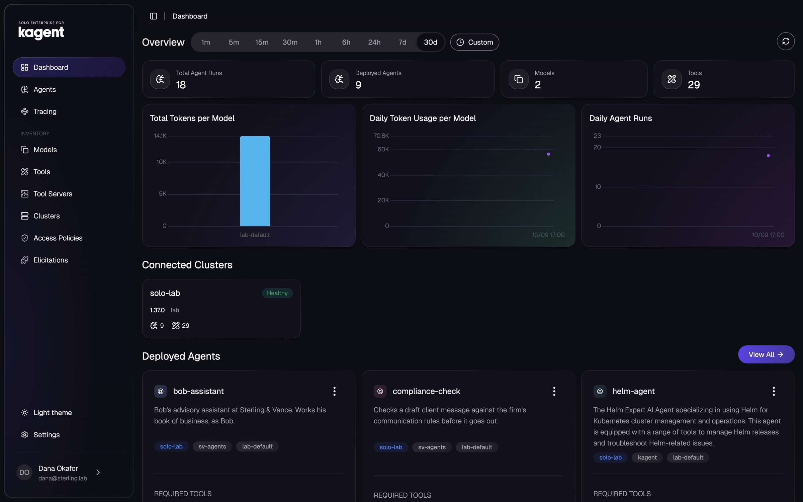 | 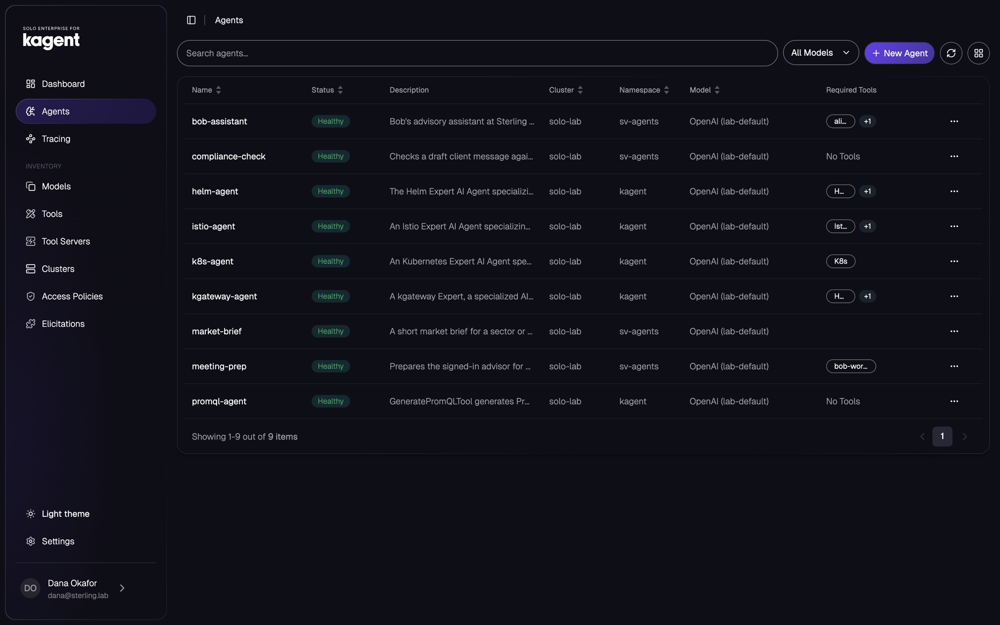 |
| **kagent** agents, runs and tokens | **kagent** agents with their models and tools |
| 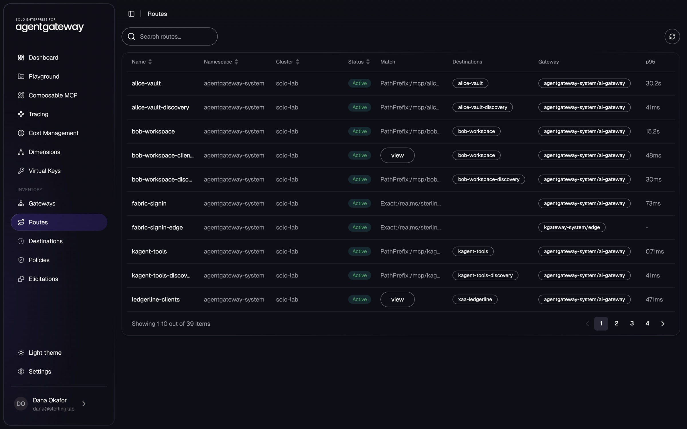 | 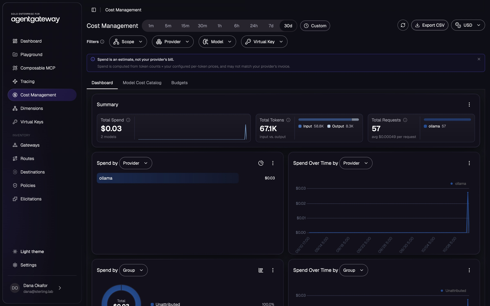 |
| **agentgateway** routes behind the AI gateway | **agentgateway** cost per call, by provider |

The Observatory, on identity and model continuity:

| | |
| --- | --- |
| 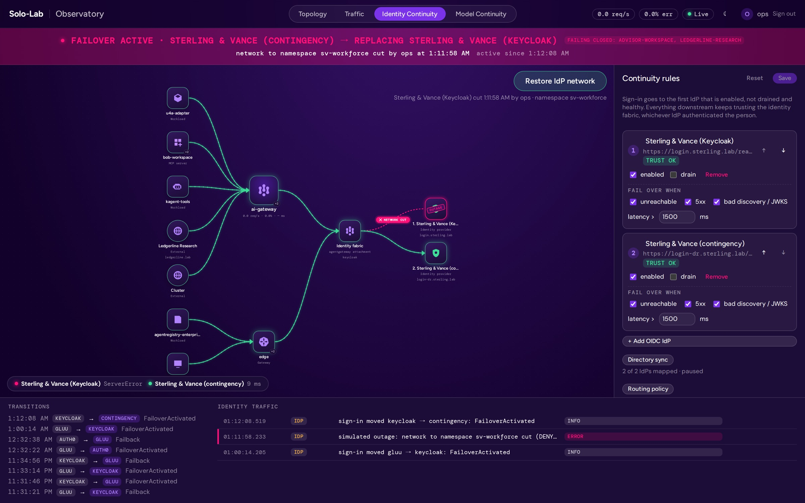 | 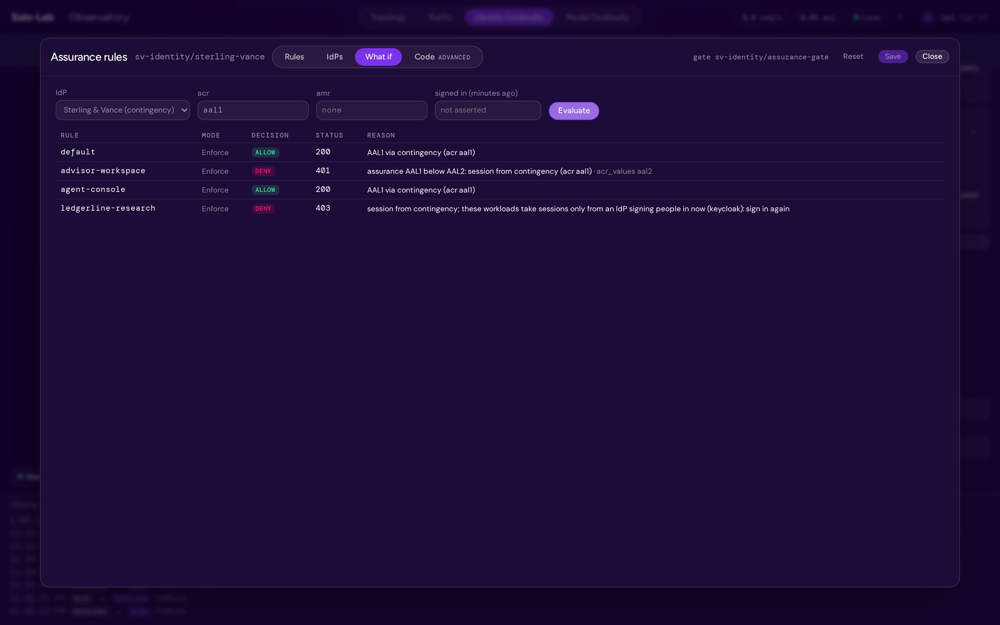 |
| **IdP failover** after a real network cut | **Assurance what-if**, refused below AAL2 with the reason |
| 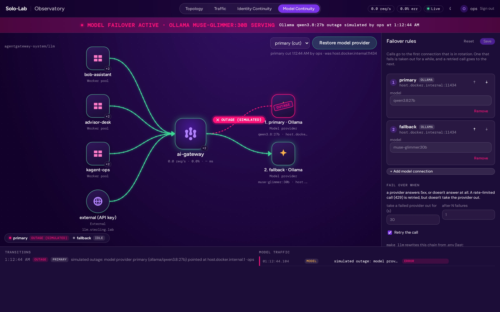 | 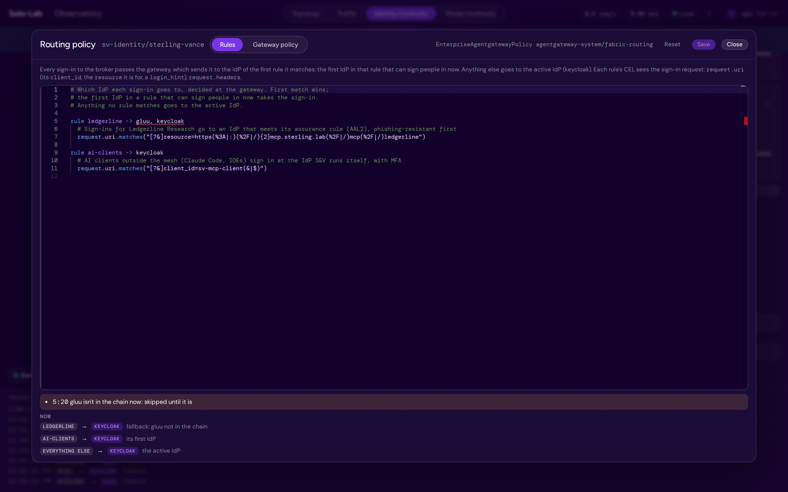 |
| **Model failover** at the gateway | **Routing policy** as rules in CEL |

More in [OBSERVATORY.md](docs/OBSERVATORY.md), and the
[3-minute walkthrough](https://youtu.be/Y3P4a7HRvVs).

Agentshield, on lateral movement ([AGENTSHIELD.md](docs/AGENTSHIELD.md)):

| | |
| --- | --- |
| 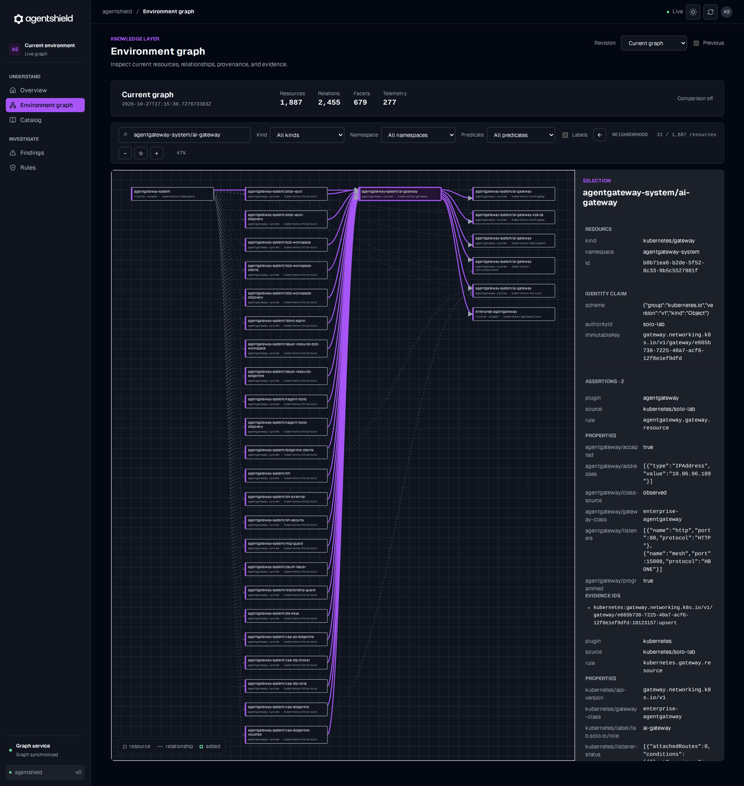 | 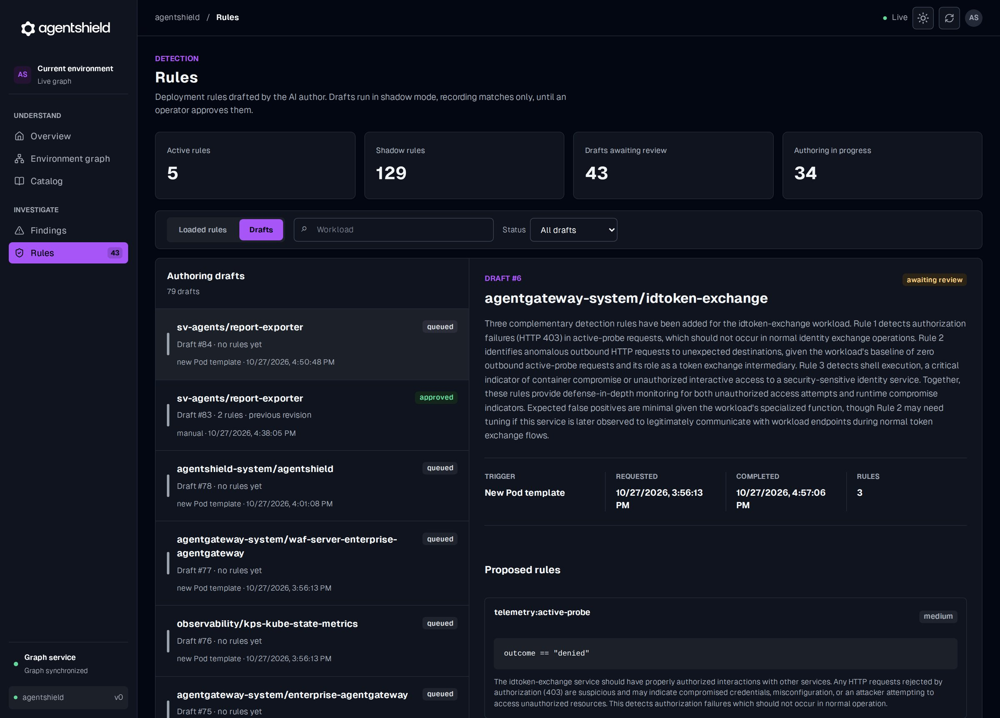 |
| **The graph** around the ai-gateway: routes, backends, policy | **Rules drafted by the model** from each workload's traffic, routed through the AI gateway |
| 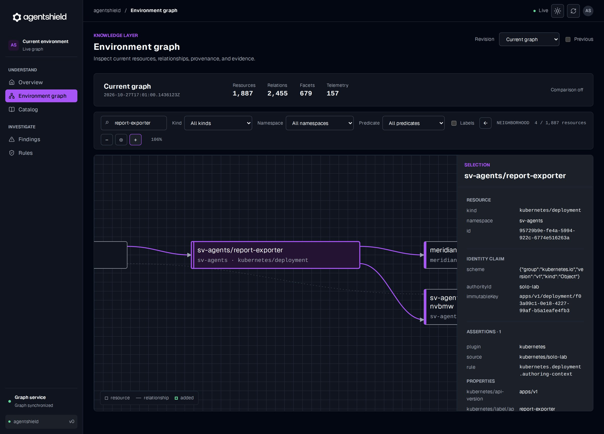 | 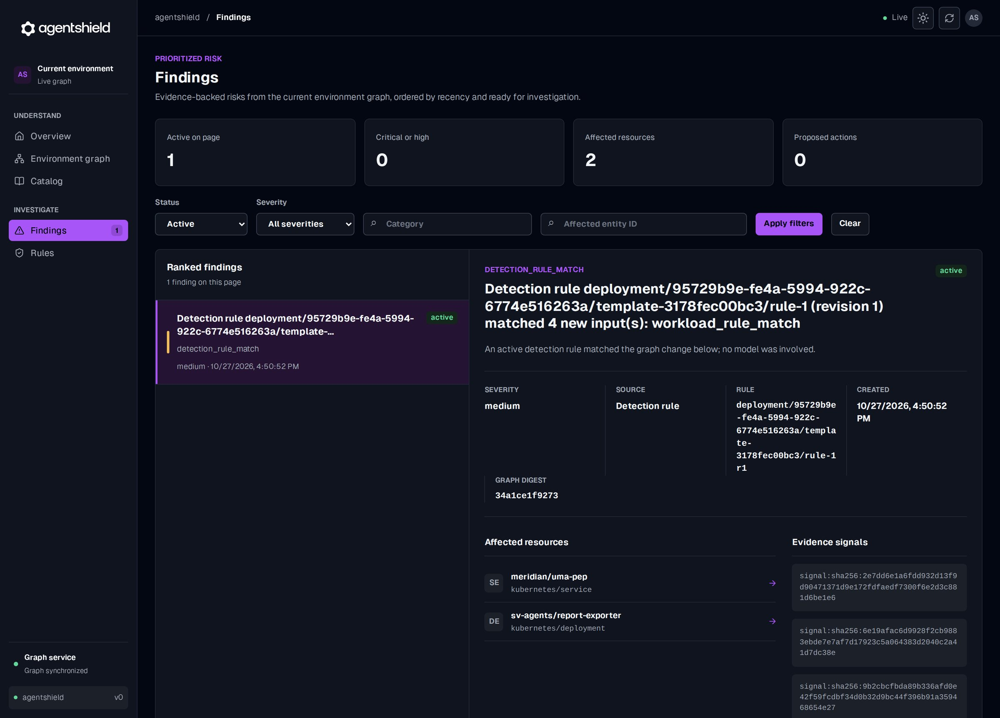 |
| **A new path** from S&V's agents into Meridian | **A finding** with its evidence, from an approved rule |

## Docs

| Doc | Covers |
| --- | --- |
| [SETUP.md](docs/SETUP.md) | requirements, machine setup, accounts, configuration, every `make` target, layout and layers |
| [ARCHITECTURE.md](docs/ARCHITECTURE.md) | parties, workloads and identities, enforcement layers, DNS and TLS, patches |
| [IDENTITY-FLOWS.md](docs/IDENTITY-FLOWS.md) | acting for a user (RFC 8693), Cross App Access (ID-JAG), UMA for agents: every hop, policy and check |
| [IDENTITY-CONTINUITY.md](docs/IDENTITY-CONTINUITY.md) | the IdP chain, the IdentityContinuity API, directory sync, trust across IdPs, assurance rules, the kill switch |
| [OBSERVATORY.md](docs/OBSERVATORY.md) | the Observatory's tabs, how it builds its map, its access model |
| [COMMANDS.md](docs/COMMANDS.md) | terminal commands for every part of the running lab |
| [AGENTSHIELD.md](docs/AGENTSHIELD.md) | Agentshield in the lab: its graph, the waypoints' traffic, its model route, access |
| [DATADOG.md](docs/DATADOG.md) | sending the lab's telemetry to Datadog: APM, LLM Observability, logs and metrics |
| [ENTERPRISE.md](docs/ENTERPRISE.md) | switching products to Solo Enterprise |
| [IDPS.md](docs/IDPS.md) | adding Auth0, Gluu, Okta, Ping or any OIDC IdP; Ledgerline's authorization server |
| [GLUU.md](docs/GLUU.md) | Gluu as S&V's IdP and Ledgerline's authorization server |
| [test-results/](docs/test-results/README.md) | runs against IdPs and authorization servers outside the lab, with their raw logs |

Solo Enterprise editions, trial licences and support: [solo.io/get-started](https://www.solo.io/get-started).

## License

This repository's own code and docs are [Apache-2.0](LICENSE). The Solo
products it installs, and the upstream projects patched in `tools/`, keep their
own terms ([NOTICE](NOTICE)).
