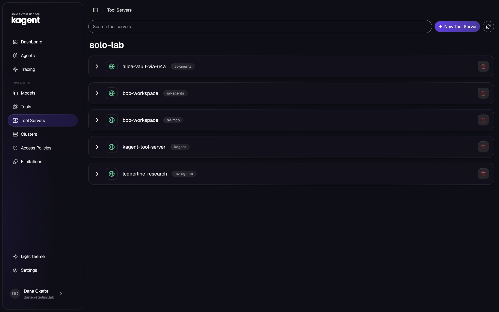
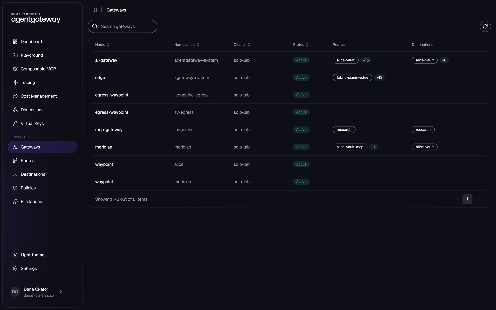
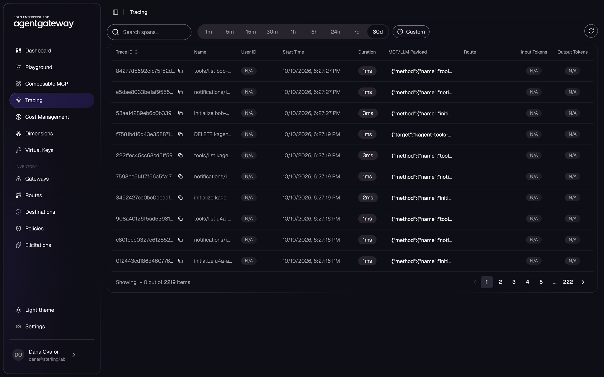

# Moving to Solo Enterprise

Trial licences and pricing: [solo.io/get-started](https://www.solo.io/get-started). Product
documentation for every edition: [docs.solo.io](https://docs.solo.io).

Each product runs OSS by default and switches to Solo Enterprise on its own.
Set the edition in `.env`, then run `make platform` (`make up` for a new
cluster):

```bash
EDITION=enterprise                # every product
AGW_EDITION=enterprise            # or one: ISTIO_, KGATEWAY_, AGW_, KAGENT_, AGENTREGISTRY_EDITION
SOLO_LICENSE_KEY=...              # one key for all, or per product:
SOLO_AGW_LICENSE_KEY=...          # SOLO_<ISTIO|KGATEWAY|AGW|KAGENT|AGENTREGISTRY>_LICENSE_KEY
```

`config/enterprise.env` holds the enterprise charts, versions and kinds.
`scripts/lib.sh` promotes them over the OSS pins for each product set to
`enterprise`. The stories, checks and tour are the same on both editions; a
check that needs an enterprise feature counts as skipped on OSS and names
the feature.

## What Solo Enterprise adds in this lab

Each row: running config on Solo Enterprise, the check that proves it, and
the OSS edition's alternative. "Per Solo" links Solo's comparison of the
editions.

| Product | On Solo Enterprise, in this lab | OSS edition of the lab | Per Solo | Checked by |
| --- | --- | --- | --- | --- |
| agentgateway | Per-agent token rate limits on the model route, counted by the Solo rate limiter, keyed on each agent pool's mesh identity (`advisor-desk`: 2,000 tokens a minute) | none (OSS has local per-route limits, or a rate-limit server you run) | [global request- and token-based rate limiting](https://docs.solo.io/agentgateway/latest/about/overview/) | `make bob-verify` |
| agentgateway | Spend budgets in dollars or tokens per API key (`EnterpriseAgentgatewayBudget`): the developer key $5 a day, key `capped` blocked | none | [LLM spend budgets](https://docs.solo.io/agentgateway/latest/about/overview/) | `make bob-verify` |
| agentgateway | The STS mints the token each MCP server accepts: per call, the ai-gateway trades the user's verified token for one for that server alone (5 s, `MCP_TOKEN_LIFETIME`), and the server trusts only the STS's issuer (`MCP_TOKEN_ISSUER`). Only the ai-gateway may mint (mesh policy `sts-callers`); MCP servers read its keys via the gateway (`/sts/jwks.json`) | an RFC 8693 exchange at S&V's broker as client `ai-gateway` (same lifetime), issued by the broker | [Solo STS token exchange](https://docs.solo.io/agentgateway/latest/mcp/token-exchange/obo/) | `make bob-verify` |
| kgateway | A web application firewall on the edge, refusing SQL and script injection for every party's hostnames | none | [WAF](https://docs.solo.io/kgateway/latest/security/waf/overview/) | `make bob-verify` |
| kagent | The Solo UI is kagent's UI ([below](#the-solo-ui)). The controller verifies each user's token against S&V's broker and maps its groups to roles | trusted-proxy mode: the controller trusts the forwarded token, so mesh policy fences who may reach it (ARCHITECTURE.md) | [OIDC authentication, RBAC mapped to IdP groups](https://docs.solo.io/kagent/latest/about/) | `make bob-verify` |
| agentregistry | Signs users in itself; roles from the token's groups | behind the edge's SSO | [user access control](https://docs.solo.io/agentregistry/latest/about/oss-enterprise/) | sign in at https://registry.sterling.lab |
| agentregistry | A catalog of what the lab runs, read from the cluster by layer 95 (`scripts/registry.sh`): every kagent agent (model, MCP servers, instructions as a Prompt) and every MCP server, published as S&V client `agentregistry-catalog`, a platform admin. Advisors may browse it (an AccessPolicy for `AGENTREGISTRY_READERS`). With kagent Enterprise too, a `Kagent` runtime connects the registry to the kagent controller as S&V client `agentregistry` (a kagent Writer, over the mesh); the agents and MCP servers in `sv-agents` appear as unmanaged instances, and the catalog can deploy there | an empty catalog | [catalog](https://docs.solo.io/agentregistry/latest/about/oss-enterprise/) | `scripts/registry.sh` (fails if the registry refuses an entry) |
| Istio | The Solo UI at https://mesh.ops.lab: the ambient mesh's workloads, traffic and policy; platform admins sign in against the ops realm (`observatory-admins` administer) | Kiali, view-only | [Solo UI](https://docs.solo.io/istio/latest/ui/about/architecture/) | `make observatory-verify` |
| agentgateway | The Solo UI's agentgateway pages: every gateway's routes, backends and policies, traces of each model and MCP call (model, tokens, tool), a playground, cost management. Gateways send traces to the UI through the platform collector | the Observatory's Traffic view and Tempo | [Solo UI for agentgateway](https://docs.solo.io/agentgateway/latest/observability/ui/) | https://mesh.ops.lab |

Both editions run the rest of the lab the same way: MCP federation and
per-tool authorization, token exchange and Cross App Access toward tools,
prompt guards, provider failover, cost per call, API keys and format
translation, MCP guardrails, and the MCP sign-in front door for AI clients
(agentgateway's MCP authorization). On Enterprise, agentgateway's OAuth
issuer is the front door's authorization server, so any MCP client registers
itself or names itself by a client ID metadata document; OSS hands every
client the one S&V registered. Cross App Access uses agentgateway's
`crossAppAccess` (one backend, S&V's broker vouching, a fresh ID-JAG per
call, verified on the gateway's own routes), with the lab's
`idtoken-exchange` supplying the ID token from the broker
([IDENTITY-FLOWS.md](IDENTITY-FLOWS.md), section 2).

One Rego module decides assurance rules on both
([IDENTITY-CONTINUITY.md](IDENTITY-CONTINUITY.md#where-the-rules-are-decided)).
Enterprise runs it in Solo's ext-auth service (`entExtAuth` on
`EnterpriseAgentgatewayPolicy`, an AuthConfig per rule, replicated with the
class's shared extensions); OSS runs it in the lab's assurance gate
(`extAuth` on `AgentgatewayPolicy`).

Also in Solo Enterprise per Solo's pages, not yet shown in this lab:

- agentgateway: budgets and virtual keys in the Cost Management UI,
  on-behalf-of identity and claim propagation between agents and MCP tools, tool search and code mode for
  MCP, composable MCP servers, Microsoft Purview DLP, SAML subject
  assertions for Cross App Access
  ([overview](https://docs.solo.io/agentgateway/latest/about/overview/)).
- kgateway: the built-in rate-limit server, external auth with OPA, staged
  transformations ([overview](https://docs.solo.io/kgateway/latest/about/overview/)).
- kagent: multicluster agent management, controller-per-namespace
  multitenancy, STS token exchange and AccessPolicy
  ([about](https://docs.solo.io/kagent/latest/about/)).
- agentregistry: artifact approval, audit logging, runtime MCP
  authorization, discovery across clouds
  ([OSS and Enterprise](https://docs.solo.io/agentregistry/latest/about/oss-enterprise/)).
- Istio: FIPS and long-term-support builds, multicluster peering
  ([enterprise features](https://docs.solo.io/istio/latest/about/images/enterprise/)).

## The Solo UI

On Enterprise, https://kagent.sterling.lab is the Solo UI, one console with a
section for each Solo Enterprise product the lab runs. Everyone signs in as
themselves through S&V's IdP. Advisors read and chat with agents, each
seeing only their own sessions; platform engineers (`dana`) administer, and
only they see the gateway and mesh sections. Install: [Istio](#istio).

| Section | URL | What it shows here |
| --- | --- | --- |
| kagent | https://kagent.sterling.lab/ke/ | Bob's and the ops agents, chats, every run as a trace, tools and tool servers, models |
| agentgateway | https://kagent.sterling.lab/age/ | ai-gateway and every other gateway, routes, destinations, policies, MCP and model traces, cost management, the playground |
| Istio | https://kagent.sterling.lab/ie/graph | the ambient mesh graph by cluster, namespace or workload, with live traffic |

| | |
| --- | --- |
|  |  |
|  |  |
|  |  |
|  |  |
|  |  |

## Licences

Trial keys are scoped to a product (`product` in the key). With a key it
doesn't accept:

| Product | With a key it doesn't accept |
| --- | --- |
| Istio | istiod exits (`LICENSE ERROR`, `license loading failed`). With no key it runs without enterprise features such as peering. An empty `SOLO_ISTIO_LICENSE_KEY` falls back to `SOLO_LICENSE_KEY`; leave both empty to run it unlicensed |
| kgateway | logs `license validation failed` and runs; Solo warns of degraded or disabled features |
| agentgateway | logs `license validation failed` and runs; same warning |
| kagent | logs `kagent enterprise license missing or invalid` and runs |
| agentregistry | logs `agentregistry enterprise license missing or invalid` and runs |

## Versions

| Product | OSS | Enterprise |
| --- | --- | --- |
| [Istio](https://docs.solo.io/istio/) | upstream 1.31.1 | Solo Enterprise for Istio `1.31.1-solo` |
| [kgateway](https://docs.solo.io/kgateway/) | 2.4.6, GatewayClass `kgateway` | Solo Enterprise for kgateway 2.3.5, `enterprise-kgateway` |
| [agentgateway](https://docs.solo.io/agentgateway/) | 1.6.0, `agentgateway` | Solo Enterprise for agentgateway v2026.9.3, `enterprise-agentgateway` |
| [kagent](https://docs.solo.io/kagent/) | 0.10.3 + `tools/kagent` | Solo Enterprise for kagent 0.5.10 + `tools/kagent`'s Go ADK |
| [agentregistry](https://docs.solo.io/agentregistry/) | 0.4.0, behind edge SSO | agentregistry-enterprise 2026.9.0, its own sign-in |

## What changes, per product

### Istio

Solo-built images (`global.hub`/`tag`), the licence on istiod, peering
enabled.

Layer 90 adds the Solo UI (the `management` chart, in `solo-enterprise`;
`ENT_ISTIO_UI_*` in `config/enterprise.env`) when any of kagent,
agentgateway or Istio runs Enterprise, with pages on for each product that
does. Its S&V clients are `kagent-ui` (browser) and `kagent` (backend);
roles come from groups, `platform-admins` administering. ClickHouse and two
collectors run beside it. Mesh policy lets only the edge reach the UI, and
only the UI reach kagent's controller on a user's behalf. It needs an
Enterprise-level licence (`SOLO_UI_LICENSE_KEY`, else
`SOLO_ISTIO_LICENSE_KEY`).

### kgateway

- GatewayClass `enterprise-kgateway` (templated everywhere).
- Kubernetes 1.37 rejects the `EnterpriseKgatewayTrafficPolicy` CRD as over
  its CEL cost budget, so layer 30 installs a local copy of the CRD chart
  without the offending rules (format checks on durations, sizes and
  rate-limit entries).
- Enterprise kgateway and agentgateway both ship Solo's ext-auth,
  rate-limit and WAF CRDs. A CRD belongs to one helm release, so the first
  installed (kgateway, layer 30) keeps them and layer 40 leaves them out.

### agentgateway

- Parameters and policy kinds (`EnterpriseAgentgatewayParameters`,
  `EnterpriseAgentgatewayPolicy`), templated, ReferenceGrants included.
- The controller is `enterprise-agentgateway` (labels and ServiceAccount).
  S&V's mesh policy names it by release (xDS port, the STS, metrics,
  Keycloak's JWKS caller).

### kagent

0.5.10 keeps OSS kagent's agent model (SandboxAgents on Agent Substrate
0.0.9, layer 50), CRDs and controller API; the agents and checks carry over.

- **Authentication:** the controller verifies every token against S&V's
  Keycloak (`oidc.*`). Roles come from the `groups` claim (`platform-admins`
  and `platform-engineers` admin, `advisors` reader). The Observatory's
  client reads Substrate status; agentregistry's client (its kagent runtime)
  is a writer. `oidc.skipOBO` passes the user's own token to agents, which
  the front door's checks on every tool call need.
- **Go ADK:** `tools/kagent`'s build, pinned by digest
  (`GOLANG_ADK_IMAGE_DIGEST`); SandboxAgents call the controller back with
  the caller's credential.
- **Beyond the chart** (`platform/60-kagent/enterprise.yaml`): a read on
  GatewayClasses, which the controller watches and the chart's
  namespace-scoped roles omit, and the mesh policy that lets the Solo UI
  reach the controller's API (8083). The licence Secret comes from
  `install.sh`.
- Agents get the caller's access token, not the ID token; for Cross App
  Access the egress gateway gets the ID token itself (IDENTITY-FLOWS.md,
  section 2).
- The chart's own UI is off; kagent's UI is the Solo UI (layer 90,
  [Istio](#istio)).

### agentregistry

- Signs people in itself (`oidc.*`). The UI runs PKCE as public client
  `agentregistry-ui`; the server validates tokens issued to `agentregistry`;
  roles come from `groups` (`platform-admins` superuser). The edge only
  routes, with no OAuth2 filter, and sends `/mcp` to its MCP port.
- Trusts the lab CA from trust-manager's bundle; its ClickHouse has its own
  password.
- Its database, ClickHouse and collector admit only the server's identity.
- It runs as root, so its namespace has no `restricted` PSA.
- With kagent Enterprise too, `scripts/registry.sh` connects its kagent
  runtime to the controller as S&V client `agentregistry`, a kagent writer.

The patches under `tools/` are independent of edition. Drop each one when
its upstream change ships.
