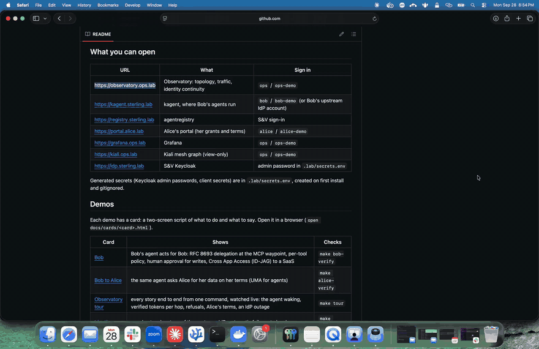

# Identity continuity

Sterling & Vance's broker is Keycloak at `https://idp.sterling.lab`, realm
`sterling-vance`. It routes workforce sign-in to an ordered chain of the
firm's IdPs (`ENTERPRISE_IDP`: Okta, Auth0, Gluu, the Keycloak S&V runs
itself, or its password-only contingency IdP) and maps each into one profile.
It is not a workforce IdP: it holds no employee passwords, only break-glass
accounts for platform admins.

S&V's services trust only the broker. When an IdP goes down, new sign-ins move
to the next healthy one, and downstream keeps the same issuer, `sub` and
groups. The firm's gateway sends each sign-in to an IdP by [routing
rules](#routing), else to the active one. Through Cross App Access the broker
also vouches for S&V's users to apps such as Ledgerline, which trust one
issuer and never see the chain or its failover
([IDENTITY-FLOWS.md](IDENTITY-FLOWS.md#2-cross-app-access-id-jag-to-a-saas)).

Failover must not lower what a sign-in proves. The broker carries what the
upstream proved ([assurance](#assurance)), and [assurance
rules](#assurance-rules) at the workloads' gateways refuse what falls short.
The controller also checks that every IdP still accepts S&V's registration as
the broker uses it ([trust across IdPs](#trust-across-idps)).

[](videos/identity-continuity.mp4)

- API and controller: `apps/continuity` (`IdentityContinuity` and `WorkloadProfile`, `continuity.lab.solo.io/v1alpha1`; decision logic in `internal/assurance/assurance.rego`; the assurance gate is its `gate` command)
- Install: `platform/47-continuity` (`make layer-47`, after `45-identity`)
- Demo cards: [cards/identity-continuity.html](cards/identity-continuity.html) (failover), [cards/assurance.html](cards/assurance.html) (assurance rules)
- Checks: `make continuity-verify`

```bash
kubectl --context kind-solo-lab get idc,wlp -n sv-identity
```

## The resource

The chain comes from `ENTERPRISE_IDP` in `config/lab.env` (default
`auth0,keycloak,contingency`, any order), followed by `break-glass`. An IdP
without `<NAME>_ISSUER` in `.env` is left out, so with no Auth0 tenant the lab
signs people in through S&V's own Keycloak, then its contingency IdP. Failback
is automatic (`platform/47-continuity/identitycontinuity.yaml`).

Each IdP is configured by name: `<NAME>_ISSUER`, `<NAME>_CLIENT_ID` and the
rest of [its settings](IDPS.md#settings). The lab ships two. `keycloak` is the
Keycloak S&V runs itself (`https://login.sterling.lab`, realm `workforce`,
password and one-time code). `contingency` is its password-only IdP for when
that one is down (`https://login-dr.sterling.lab`).

Every IdP in the chain is trusted for S&V's workforce, so chain only IdPs
authoritative for S&V's users. A user who signs in through one is linked to
the S&V account with the same verified email, so `sub` and group membership
never change. The broker holds the shape every IdP maps into and has no
directory of its own. Its accounts come from the [directory
sync](#directory-sync), without passwords; none is created at sign-in. The
realm file also carries the demo profiles (`bob`, `carol`, `dana`) with fixed
ids, so a broker restart keeps each one's `sub`; they hold no credentials or
groups.

Accounts with role `local-only` (the `platform-admins` group: break-glass and
platform admins) are never linked to an upstream. With every IdP down, only
they can sign in. Only the active IdP is enabled at the broker. The others
keep their users' links but can't sign anyone in, even by `kc_idp_hint`.
During a failover the active IdP is the primary, and the broker applies what
its sign-ins assert (claims, groups).

The broker authenticates to an upstream with `private_key_jwt`
(`tiers[].oidc.clientAuth`), signing with a PS256 realm key kept for that
alone. Its public half is in the realm's JWKS and in `make xaa-keys`
(`sv-upstream-client.jwks.json`). Given `<NAME>_CLIENT_SECRET` in `.env`, it
uses `client_secret_post` instead ([Auth0](IDPS.md#auth0-auth0)).

Each upstream's ServiceEntry is exported to `sv-identity`, so every S&V call
to an upstream leaves through `sv-egress/egress-waypoint`, where a partition
cuts all of them. Cross App Access calls no upstream. The broker vouches, and
the assurance gate refuses a session from an IdP that is no longer active.

Re-running the layer resets the chain to `ENTERPRISE_IDP`, removing any IdP
added in the rule builder or by hand. It keeps what operators set per IdP
(display name, enabled, drain, failover rules, attributes, directory), and
leaves `spec.profile` and `spec.sync` alone. `.env` sets issuers, client IDs,
client authentication and token settings.

| `ENTERPRISE_IDP` | Sign-in |
| --- | --- |
| `keycloak` | S&V's own Keycloak |
| `auth0,keycloak,contingency` (default) | Auth0, else S&V's own Keycloak, else its contingency IdP |
| `keycloak,contingency` | S&V's own Keycloak, else its contingency IdP (the default without an Auth0 tenant) |
| `okta,auth0,keycloak` | Okta, else Auth0, else S&V's own Keycloak |
| `keycloak,auth0` | S&V's own Keycloak, else Auth0 |
| `gluu,auth0,keycloak,contingency` | Gluu, else Auth0, else S&V's own Keycloak, else its contingency IdP ([IDPS.md](IDPS.md#gluu-gluu)) |

`make verify` and `make tour` sign Bob in through S&V's own Keycloak
(password, then a one-time code computed from his seed), so `keycloak` must be
in `ENTERPRISE_IDP`. They drain the IdPs ahead of it for the run and restore
the chain on exit. The assurance-rule failover checks also need `contingency`
after it.

### What the broker realm must already have

The controller manages identity providers and one redirector setting. It
creates no flows or roles, so the realm needs these first (all in
`platform/45-identity/realm-sterling-vance.json`):

- a browser flow (`continuity-browser`) with an Identity Provider Redirector
  execution, bound as the realm's browser flow;
- a first-broker-login flow (`continuity-first-broker-login`) that detects
  the existing user and links automatically (`idp-detect-existing-broker-user`,
  `idp-auto-link`);
- a service-account client with realm-management `manage-identity-providers`
  and `manage-realm` (the redirector's config and the user profile are realm
  config), for `broker.keycloak.credentialsRef`;
- for `sync`, a second service-account client (`continuity-sync`) with
  realm-management `view-users` and `manage-users` only, for
  `sync.credentialsRef`;
- for assurance rules, client scope `continuity-assurance` on the clients
  users sign in through, which puts the session notes `continuity.acr`,
  `continuity.amr` and `continuity.auth_time` in tokens as `idp_acr`,
  `idp_amr` and `idp_auth_time`; and `view-clients` on the controller's
  client, to read those clients' registrations;
- the identity provider mapper `continuity-session-claims-idp-mapper`
  (a provider in the broker's image, `tools/keycloak-idjag/session-claims`).

### spec

| Field | Meaning |
| --- | --- |
| `broker.keycloak.url` | in-cluster Keycloak base URL (admin API) |
| `broker.keycloak.realm` | realm to manage |
| `broker.keycloak.credentialsRef` | Secret with `client-id`/`client-secret` of a service-account client with realm-management `manage-identity-providers` and `manage-realm` |
| `broker.keycloak.browserFlow` | browser flow whose Identity Provider Redirector points at the active tier (`continuity-browser`) |
| `broker.keycloak.firstBrokerLoginFlow` | first-broker-login flow for every upstream (`continuity-first-broker-login`: link to the existing user) |
| `egress.namespace`, `egress.waypoint` | route back-channel calls to external upstreams through this waypoint (one ServiceEntry per external IdP) |
| `egress.internalDomains` | hosts under these domains are in-cluster and get no ServiceEntry |
| `egress.exportTo` | other namespaces that call upstreams: the ServiceEntries are exported there too (agentgateway's control plane, for a vouching IdP's keys with `XAA_VOUCHER`) |
| `tiers[]` | ordered; the first eligible, healthy tier is active |
| `tiers[].name` | also the Keycloak IdP alias |
| `tiers[].displayName` | shown on the login page and in the Observatory |
| `tiers[].type` | `oidc` (an IdP) or `local` (the broker's break-glass accounts) |
| `tiers[].enabled` | `false`: never active, Keycloak IdP disabled |
| `tiers[].drain` | out of rotation; sessions in flight keep working |
| `tiers[].oidc.issuer` | exactly as the upstream publishes it (Auth0's ends in `/`) |
| `tiers[].oidc.clientID` | falls back to the Secret's `client-id` key; required with `private_key_jwt` |
| `tiers[].oidc.clientAuth` | `client_secret_post` (default), `client_secret_basic` or `private_key_jwt` |
| `tiers[].oidc.clientAssertionSigningAlg` | `PS256`: the realm key kept for client assertions |
| `tiers[].oidc.clientSecretRef` | Secret and key (default `client-secret`); required unless `clientAuth` is `private_key_jwt`; missing means `NotConfigured` |
| `tiers[].oidc.scopes` | default `openid email profile` |
| `tiers[].oidc.storeTokens` | keep the IdP's tokens on each user's link |
| `tiers[].attributes[]` | the IdP's attributes paired with S&V's profile for the directory sync: `attribute` (built-in or `profile.attributes`) and `path` (the attribute in the IdP's user record) |
| `tiers[].directory` | where the sync reads and writes this IdP's users: `type` (`scim`, `auth0`, `keycloak`), `url`, `credentialsRef` (`client-secret`, and `client-id` unless `clientID` is set), `scopes`, `audience` (Auth0) |
| `tiers[].directory.clientID` | the directory client's ID; falls back to the Secret's `client-id` key |
| `tiers[].groups.claim` | the ID token claim with the IdP's groups (or roles); unset: no groups are read from its sign-ins, and the directory sync maps them ([Groups](#groups)) |
| `tiers[].assurance.levels[]` | what the IdP's sign-ins prove: an `acr` value, or one `amr` value, mapped to a NIST SP 800-63B `level` (`AAL1`, `AAL2`, `AAL3`), and whether that authenticator is `phishingResistant` |
| `tiers[].assurance.default` | the level of a sign-in that asserts none of them (default `AAL1`); for a local tier, its only level |
| `tiers[].failoverWhen` | which probe results count against the tier: `unreachable`, `serverError`, `invalidDiscovery` (each default true), `latencyAboveMs` (must be below `health.timeoutSeconds`: a slower answer times out first) |
| `health` | `intervalSeconds`, `timeoutSeconds`, `unhealthyThreshold` (failures in a row to go down), `healthyThreshold` (successes in a row to come back) |
| `failback` | `Automatic` (move back up as soon as a higher tier is healthy) or `Manual` |
| `profile.attributes[]` | S&V's profile beyond `username`, `email`, `firstName`, `lastName`: `name`, `displayName`, `type` (`string` default, `integer`, `number`, `boolean`, `date`, `email`, `uri`: checked by the broker), `multivalued` (a list) |
| `sync.schedule` | cron, UTC; `sync.suspend` pauses it |
| `sync.removeMissing` | remove the broker account (and its failover accounts) of a workforce user the primary no longer has or has disabled ([Directory sync](#directory-sync)) |
| `sync.credentialsRef` | Secret with the sync's realm client (default `continuity-sync`) |
| `routing.policy` | the gateway policy the controller writes the routing into: `apiVersion`, `kind`, `namespace`, `name` (an agentgateway policy on the broker's sign-in route) |
| `routing.rules[]` | first match wins: `name`, `when` (CEL over the sign-in request), `idps` (oidc tiers, in order: the first that can sign people in now takes the sign-in), `description` ([Routing](#routing)) |

### status

- `active`: where logins go now (the tier Keycloak's redirector points at,
  or the local tier); `activeSince`; `broker.issuer`; `egressNamespace`
- per tier: `configured`, `healthy`, `partitioned`, `latencyMs`, `reason`,
  `message`, consecutive failures and successes, `redirectURI` (the callback
  the upstream app must allow) and `trust` ([trust checks](#trust-across-idps))
- `transitions`: the last 20
- `sync`: CronJob, last run and last success, users, broker accounts
  provisioned and removed, S&V profiles updated, failover accounts written
  and created, failures, and each IdP's attribute paths as its directory
  last showed them
- `broker.signIn`: the broker's browser sign-in clients and their redirect URIs
- conditions: `Ready`, `Degraded` (not on the first IdP), `RulesEffective`
  (False while a latency rule is at or above the probe timeout),
  `ProfileApplied`, `TrustConsistent` (False while an IdP fails a trust check)
- events: `TierHealthy`, `TierUnhealthy`, `FailoverActivated`, `Failback`,
  `TrustMismatch`, `CleanupAbandoned`

## What the controller does

Two replicas, one leader (Lease `continuity.lab.solo.io` in `sv-identity`).
Every `health.intervalSeconds`, the leader:

1. **Probes each tier.** `oidc`: fetch discovery and JWKS within
   `timeoutSeconds`; every endpoint in the discovery document must be https.
   Results: `Healthy`, `Unreachable`, `ServerError`, `InvalidDiscovery`,
   `SlowResponse`. `local`: healthy while Keycloak is reachable. A tier
   without credentials is probed but `NotConfigured`. A probe counts toward
   the thresholds at most once per interval, so editing the spec doesn't
   speed up a failover.
2. **Picks the active tier**: the first that is enabled, not drained,
   configured and healthy, else the first enabled, undrained local tier.
   With `failback: Manual` it stays put until the current tier fails. While
   Keycloak itself is unreachable the active tier holds.
3. **Makes Keycloak match** through its admin API:
   - one OIDC identity provider per configured `oidc` tier (hidden from the
     login page when not eligible), with PKCE S256, the tier's
     `oidc.clientAuth` (`private_key_jwt` with the broker's PS256 key, or a
     client secret), and a check that accepts only `email_verified: true`,
     from the ID token or, when the ID token doesn't carry it, userinfo
     (mapper `continuity-email-verified`; until an IdP has it, Keycloak's
     own filter checks the ID token). A setting changed by hand in Keycloak is put
     back. If a tier's Secret goes missing, its IdP stays (hidden) so users'
     links survive; only removing the tier from the spec deletes it;
   - the `continuity-browser` flow's IdP redirector set to the active tier,
     or cleared when the active tier is `local`, so the broker's own form
     shows (platform admins only);
   - on each IdP, the mapper `continuity-assurance`
     ([assurance](#assurance)). Without it a session proves nothing beyond
     its IdP's default, so it never holds up sign-ins; `Ready` says why.
4. **Keeps the egress path**: a ServiceEntry `sv-egress/continuity-<idp>`
   per external upstream, bound to `sv-egress/egress-waypoint`, so the
   back-channel (probes, token, JWKS, userinfo) leaves the lab under S&V
   policy. A ServiceEntry of that name owned by another instance is left
   alone and reported. Old ones are removed when `spec.egress` changes or
   goes away.
5. **Checks trust** every 10 minutes and on every change
   ([trust across IdPs](#trust-across-idps)).

Deleting an IdentityContinuity removes its IdPs and ServiceEntries and clears
the redirector. If Keycloak stays unreachable for 5 minutes, the controller
skips that cleanup (event `CleanupAbandoned`) so the deletion isn't held up.

The first-broker-login lookup (`idp-detect-existing-broker-user`,
`idp-auto-link`) matches by email or username. Each managed IdP therefore
carries a username mapper (`username-from-email`) that sets the brokered
username to the verified email. Without it, an upstream account named `bob`
would be linked to S&V's Bob whatever its email.

The controller's RBAC in `sv-identity` covers the IdentityContinuity
resources, a Lease, events, the profile-sync CronJob, and `get` by name on the
Secrets it is configured with (Role `continuity-controller-secrets`). It
cannot list or watch Secrets, so it never sees Keycloak's own admin or
signing-key Secrets. Credentials are re-read on every reconcile, so a rotated
secret takes effect within one interval. The ServiceEntry applies through
Istio ambient's DNS capture (`AMBIENT_DNS_CAPTURE`, on in 1.31).

## Directory sync

On a schedule (`spec.sync`), the directory sync keeps every IdP in the chain
in step with the primary through S&V's profile on the broker, so whichever is
active signs each employee in with the same profile:

1. **Primary → S&V's profile.** The chain's first IdP is the primary and
   says who exists, even during a failover. The sync gives the broker an
   enabled account for each primary user with a verified email under one of
   `spec.profile.domains` (`status.sync.provisioned`). With
   `spec.sync.removeMissing` (`SV_SYNC_REMOVE_MISSING`, default `true`; the
   Observatory's Directory sync, Schedule), it then removes the broker and
   failover accounts of each workforce user the primary no longer has or
   has disabled (`status.sync.removed`). It removes only after a complete,
   non-empty listing, and changes nothing while the primary can't be read.
   Accounts with role `local-only` (break-glass) and service accounts stay.
   It then writes each employee's mapped attributes and groups
   ([Groups](#groups)) from the primary's directory into S&V's profile, the
   standard every IdP maps to.
2. **S&V's profile → each failover.** It writes S&V's profile to every other
   IdP with a directory, through that IdP's mapping. A user missing at a
   failover is created there, and the failover emails them to set their own
   password (Keycloak's "execute actions" email; the realm needs its SMTP
   settings). A directory that can't create a user without a password
   (Auth0) reports them instead. Groups go out where the directory can
   write them (Keycloak groups, Auth0 roles).

The lab's workforce realm has no SMTP server, so a user the sync creates there
is listed in the run's message and can't sign in at that IdP yet.

Reorder the chain and the roles follow. A user is found at an IdP by the
broker's link, else by email (one match, never a guess; at a SCIM directory,
only the record whose primary email it is). SCIM listings follow the
directory's page size, and a rate limit (`429`) is waited out a few times. The
sync reads each record back after writing it and reports any attribute the
directory drops. It never reads or writes a credential, never writes the
username, and deletes a user only with `removeMissing`. Tokens carry the
standard claims only.

```yaml
spec:
  profile:
    attributes: [{name: department, displayName: Department}]
  sync: {schedule: "0 2 * * *"}
  tiers:
  - name: auth0                      # primary: read
    attributes:
    - {attribute: firstName, path: given_name}
    - {attribute: department, path: user_metadata.department}
    directory: {type: auth0, url: https://<tenant>/api/v2, audience: https://<tenant>/api/v2/,
      credentialsRef: {name: directory-auth0}}
  - name: keycloak                   # failover: written
    attributes:
    - {attribute: firstName, path: firstName}
    - {attribute: department, path: department}
    directory: {type: keycloak, url: http://keycloak.sv-workforce.svc/admin/realms/workforce,
      credentialsRef: {name: directory-keycloak}}
  - name: contingency                # failover: written
    attributes:
    - {attribute: department, path: department}
    directory: {type: keycloak, url: http://keycloak.sv-contingency.svc/admin/realms/contingency,
      credentialsRef: {name: directory-contingency}}
```

| Directory | Client | Paths |
| --- | --- | --- |
| `scim` (Gluu, Ping, most enterprise IdPs) | `client_credentials` with the SCIM read and write scopes | `name.givenName`, `emails[primary eq true].value`, `urn:ietf:params:scim:schemas:extension:enterprise:2.0:User:department` |
| `auth0` | Machine-to-Machine app for the Management API, `read:users`, `update:users` | `given_name`, `user_metadata.department`, `app_metadata.<key>` |
| `keycloak` | service-account client with `view-users`, `manage-users` in that realm | `firstName`, `department` (the realm's user profile must keep it, or allow unmanaged attributes) |

Auth0 has no SCIM API for its own users; its Management API is the directory.
**Test connection** (`sync --test-tier <idp>`, a Job from the CronJob) uses
the sync's own path and credentials to get a token, count the users and read
the directory's attribute schema. Its result (never user records) is the
container's termination message.

Layer 47 runs the sync once at install. Layer 45 runs it again right after
deploying the broker, whose accounts are in memory, so the broker has its
users before anyone signs in.

The sync runs as ServiceAccount `continuity-sync`: `get` on its instance,
`patch` on its status, and `get` by name on its own and the directories'
Secrets (Role `continuity-sync-secrets`). It reaches the broker and the
directories under the controller's mesh policy, and directory hosts get
ServiceEntries on the IdP's egress path.

### Groups

The shape has groups as well as attributes (`spec.profile.groups`; in the lab,
`SV_GROUPS` in `config/lab.env`: `advisors`, `platform-engineers`,
`compliance`). Policies and roles name them (an agent workload acting for an
advisor; the Solo UI's administrators). Membership always comes from an IdP:

- **At sign-in**, just in time. Each upstream uses sync mode *Force*, so the
  token's email and names replace what the broker had. Each IdP lists the
  user's groups in its ID token (`tiers[].groups.claim`,
  `<NAME>_GROUPS_CLAIM` in `.env`, `groups` unless set), and the token is the
  truth. The controller keeps one Keycloak *Advanced Claim to Group* mapper
  per shape group on that IdP, also in *Force* mode, so a group the IdP
  takes away is gone at the next sign-in. A namespaced claim (Auth0's) is
  read whole.
- **In the directory sync.** The primary's groups (or roles) are read into
  the broker by name and written out to each failover, so the next IdP in
  the chain asserts the same groups after a failover. A primary with no
  directory, or one that doesn't list groups, says nothing about them, and
  the failovers keep their own. The sync also fills in the rest of the
  profile between sign-ins.

The broker's own groups beyond the shape, such as `platform-admins` (its
break-glass accounts), never come from an IdP and are left alone. The sync
creates the shape's groups at the broker (it holds `manage-users`); the
controller only manages the mappers.

### Keeping a lab's profile and mappings

The install maps each IdP's name and email into S&V's profile (Auth0:
`given_name`, `family_name`, `email`). Anything more, such as a `department`
attribute and where each IdP keeps it, is set in the Observatory's Directory
sync window and lives in the cluster. To keep it across `make down` /
`make up`, put the profile attributes, IdP mappings and an optional sync
schedule in `config/continuity.local.yaml` (gitignored; format in
`config/continuity.example.yaml`). A fresh install takes it as is;
`make layer-47` on an existing lab adds only what the instance lacks.

## Routing

Every sign-in to the broker passes the firm's gateway first. The edge sends
the broker's authorization endpoint, and only that, to the ai-gateway. Its
policy `fabric-routing` sets the broker's IdP hint and puts it first in the
request (`platform/47-continuity/routing.yaml`). The broker reads the first
hint and refuses a request with a second, so a client can't choose its own
IdP. Tokens, keys and the login pages go straight to the broker.

The identity team's rules live in `spec.routing.rules`. Each has a CEL
condition over the sign-in request (agentgateway's request variables:
`request.uri` with its `client_id`, the `resource` it is for, a `login_hint`;
`request.headers`) and IdPs in order of preference:

```yaml
routing:
  policy: {apiVersion: enterpriseagentgateway.solo.io/v1alpha1, kind: EnterpriseAgentgatewayPolicy,
           namespace: agentgateway-system, name: fabric-routing}
  rules:
  - name: ledgerline
    when: 'request.uri.matches("[?&]resource=https(%3A|:)(%2F|/){2}mcp.sterling.lab(%2F|/)mcp(%2F|/)ledgerline")'
    idps: [okta, keycloak]
  - name: ai-clients
    when: 'request.uri.matches("[?&]client_id=sv-mcp-(client|issuer)(&|$)")'
    idps: [okta, keycloak]
```

The install gives both rules S&V's IdPs whose sign-ins can meet AAL2 (their
declared `assurance`), in failover order: people sign in at the primary while
it can. A default rule that names an IdP no longer in the chain follows the
chain again when the layer is re-run.

On every pass the controller resolves each rule to the first IdP in its list
that can sign people in now (enabled, not drained, configured, healthy, set up
at the broker), else the active tier. It writes the result into the gateway
policy as one CEL expression and into `status.routing`, so routing follows a
failover at once. An IdP a rule sends sign-ins to is enabled at the broker
alongside the active one; every other upstream stays disabled. Condition
`Routed` says what the gateway runs now; Event `RouteChanged` marks each move.

For workloads that take only sessions from an IdP signing people in now
(`sessions: ActiveIdPOnly`), a session from an IdP a rule routes to counts.
The assurance gate still judges what it proves, so a rule that falls back to a
weaker IdP fails closed where the workload needs more.

`make routes` prints each rule's IdP now and where a browser app, an AI client
and an AI client for Ledgerline land. The Observatory's **Routing policy**
window edits the rules ([In the Observatory](#in-the-observatory)).

## Kill switch

A real network partition. The controller reads no flag; it only sees its
probes fail.

```yaml
apiVersion: security.istio.io/v1
kind: AuthorizationPolicy
metadata:
  name: continuity-partition-<idp>
  namespace: sv-egress                       # external upstream
  labels: {continuity.lab.solo.io/tier: <idp>}
spec:
  targetRefs: [{group: networking.istio.io, kind: ServiceEntry, name: continuity-<idp>}]
  action: DENY
  rules: [{}]
```

For an upstream inside the lab, the policy goes in that upstream's namespace
without `targetRefs`. Delete the policy to heal. Status marks the IdP
`partitioned` for information only.

With the default health settings (5 s interval, 2 failures, 3 successes),
failover takes about 10 s after the cut and failback about 15 s after the
heal.

## Assurance

The IdP decides how strongly someone signed in, and the broker keeps its word
for it. On every sign-in through an upstream, the controller's mapper on that
IdP (`continuity-assurance`) copies the upstream's `acr`, `amr` (values joined
with spaces) and `auth_time` onto the broker session. The broker's client
scope `continuity-assurance` puts them in its tokens:

| Claim | From the upstream's | Example |
| --- | --- | --- |
| `idp` | (the IdP that authenticated the session) | `keycloak` |
| `idp_acr` | `acr` | `aal2` |
| `idp_amr` | `amr` | `pwd otp` |
| `idp_auth_time` | `auth_time` | `1791401688` |

They are session notes, so what one sign-in proved never carries over to
another session, or to a refresh after the user signed in somewhere weaker. A
claim the IdP didn't send is absent and counts as unproven.

Each IdP declares what its values mean as NIST SP 800-63B authenticator
assurance levels (`tiers[].assurance`). A session gets the highest level any
of its values maps to, else the IdP's `default`. The install sets these and
keeps what operators change:

| IdP | Maps | Default |
| --- | --- | --- |
| `keycloak` (S&V's own) | `acr aal1` → AAL1, `acr aal2` → AAL2 | AAL1 |
| `contingency` | `acr aal1` → AAL1 | AAL1 |
| `auth0` | `amr mfa` → AAL2, `acr …/pape/policies/2007/06/multi-factor` → AAL2 | AAL1 |
| `okta` | `acr urn:okta:loa:2fa:any` → AAL2, `phr` → AAL2 phishing-resistant, `phrh` → AAL3 phishing-resistant | AAL1 |
| `gluu` | `acr fido2` → AAL2 phishing-resistant | AAL1 |
| `break-glass` | | AAL1 |

An IdP whose policy for S&V's client always requires a second factor declares
`default: AAL2` (in `config/continuity.local.yaml`, or the Observatory).

S&V's own Keycloak signs the broker's users in at `aal2`, a password then a
TOTP code from an authenticator app, by level of authentication (the realm's
`acr.loa.map`; `minimum.acr.value` on S&V's client there). Its contingency IdP
asks for a password only (`aal1`). An app that needs more sends `acr_values`;
the broker passes them to the active IdP, which steps the user up. The broker
has no workforce authenticators and never raises a session's level, so a
sign-in that can't step up fails closed.

## Trust across IdPs

Failover only helps if the next IdP still accepts S&V's client as the broker
uses it; a removed callback or changed client authentication would otherwise
show up mid-outage. The controller checks each upstream in the chain every 10
minutes, on every spec change, and when the instance's
`continuity.lab.solo.io/check-trust` annotation changes (the Observatory's
**Check now**):

| Check | Passes when |
| --- | --- |
| `Callback` | the IdP accepts S&V's client with the broker's callback: an authorization request with `prompt=none` and PKCE, redirects not followed, is answered at `status.tiers[].redirectURI`. It creates no session or user; the IdP may log it as a failed silent sign-in. |
| `ClientAuth` | the IdP takes the broker's client authentication (and, for `private_key_jwt`, PS256) |
| `PKCE` | the IdP takes PKCE S256 |
| `Scopes` | the IdP offers every scope the broker asks for |
| `Claims` | the IdP issues `sub` and `email` (the broker also requires `email_verified`, from the ID token or userinfo, at sign-in) |
| `Assurance` | the acr values the tier maps are ones the IdP asserts, or the IdP issues the `amr` it maps |

Each is `Pass`, `Fail` or `Unknown` (the IdP doesn't publish what the check
needs; many omit some discovery fields). A failure sets `TrustConsistent`
False, naming the IdP and the check, with a Warning event `TrustMismatch`. The
checks are informational; only the health probes decide which IdP signs people
in.

A workload's issuer, audiences and client registrations at the broker stay the
same whichever IdP is active; a workload profile's status lists them.

## Assurance rules

Assurance rules say what a sign-in must prove to reach a resource, whichever
IdP it came through, and which IdPs may vouch for its users:

- **The default rule** (`spec.assurancePolicy` on the IdentityContinuity):
  what every rule starts from, and what a gateway policy gets when it asks
  the gate without naming a rule. As installed: AAL1, from any IdP in the
  chain, no break-glass, sessions from any allowed IdP.
- **A rule** (a `WorkloadProfile`, `wlp`, beside its IdentityContinuity in
  `sv-identity`): one group of workloads, and only what differs from the
  default rule.

```yaml
apiVersion: continuity.lab.solo.io/v1alpha1
kind: WorkloadProfile
metadata: {name: advisor-workspace, namespace: sv-identity}
spec:
  continuity: sterling-vance
  description: Bob's workspace tools behind the firm's front door, used by his agents on his behalf
  criticality: Critical
  mode: Enforce
  workloads: [{namespace: sv-mcp, serviceAccount: bob-workspace}]
  clients: [kagent]
  assurance: {minimum: AAL2}            # the rest is the default rule's
```

| Requirement | Default rule (`assurancePolicy`) | A rule (`WorkloadProfile`), unset: the default's |
| --- | --- | --- |
| Minimum assurance | `minimum` (`AAL1` default, `AAL2`, `AAL3`) | `assurance.minimum` |
| Phishing-resistant authenticator | `phishingResistant` | `assurance.phishingResistant` |
| Signed in within (`idp_auth_time`), e.g. `12h` | `maxAge` | `assurance.maxAge` |
| IdPs that may vouch (empty: every upstream) | `allowedIdPs` | `allowedIdPs` |
| Break-glass accounts | `allowBreakGlass` | `allowBreakGlass` |
| Sessions: `Any`, or `ActiveIdPOnly` (only from the IdP signing people in now; one from an IdP the chain has moved off is refused until the user signs in again) | `sessions` | `sessions` |

A rule's `mode` sets what the gate does with it:

| Mode | A request the rule refuses |
| --- | --- |
| `Enforce` (default) | is refused |
| `ReportOnly` | goes through; the gate logs and returns `would-deny` with its reason, to see a rule's effect before enforcing it |
| `Off` | goes through; the gate doesn't evaluate it |

For reporting, a rule also has `criticality` (`Critical`, `High`, `Standard`),
`workloads` (mesh identities), the broker `clients` users sign in through, and
optional `obligations`, `owner` and `description`.

Status, which a ValidatingAdmissionPolicy lets only the controller write:

| Field | Meaning |
| --- | --- |
| `phase` | `Available`: sign-ins through the IdP serving now can meet the rule. `Degraded`: they can, on a later IdP than the first that can. `FailedClosed`: they can't, and requests are refused (in `Enforce` mode) |
| `serving`, `servingLevel` | the active IdP, and the most a sign-in through it proves |
| `eligibleIdPs` | the chain's IdPs, in order, whose sign-ins can meet the rule |
| `clients[]` | each client as the broker has it: found, redirect URIs, audiences, and whether its tokens carry the upstream's assurance (`continuity-assurance`) |
| conditions | `Ready` (False: the IdentityContinuity or a client is missing, `allowedIdPs` names an IdP not in the chain, or a client's tokens can't carry assurance while the rule requires more than AAL1) |

Events `Available`, `Degraded` and `FailedClosed` (Warning, in `Enforce` mode)
follow the chain as it moves.

Bob's demo has three (`demos/bob/manifests/05-workload-profiles.yaml`):

| Rule | Criticality | Requirements | Enforced at |
| --- | --- | --- | --- |
| `advisor-workspace` | Critical | AAL2 | `agentgateway-system/bob-workspace-caller` (ai-gateway, in front of Bob's workspace) |
| `ledgerline-research` | High | AAL2, active IdP only | `agentgateway-system/xaa-ledgerline-caller` (S&V's egress to Ledgerline, before any ID-JAG) |
| `agent-console` | Standard | break-glass allowed | the kagent console's sign-in is at the edge, which doesn't ask the gate |

With S&V's own Keycloak cut and the chain on the contingency IdP,
`advisor-workspace` and `ledgerline-research` go `FailedClosed` and
`agent-console` keeps serving (`Degraded`).

### Where the rules are decided

One Rego module, `apps/continuity/internal/assurance/assurance.rego`, decides
the rules. Whatever runs it gives the same answer, so the gateways, the
Observatory's what-if and any AuthZEN client agree:

| Edition | Decides each request | How a gateway policy asks |
| --- | --- | --- |
| Enterprise | Solo's ext-auth service (`agentgateway-system`), its OPA running the module | `entExtAuth`, naming the rule's AuthConfig |
| OSS | the assurance gate (`sv-identity`), the continuity image's `gate` command, running the module through OPA's Go library | `extAuth` (Envoy external authorization, gRPC), failing closed |

The module lives in ConfigMap `assurance-policy` (key `policy.rego`, labelled
`continuity.lab.solo.io/assurance-policy`): in `agentgateway-system` on
Enterprise, `sv-identity` on OSS. The install writes it from the repo's file,
and a re-install puts that back. Admins edit it live from the Observatory,
which compiles it first. The gate reads it every 5 s and decides with each
version that compiles and defines `data.assurance.decision`. It refuses any
other, keeps deciding with the last good one, and logs why. Until it has
read the ConfigMap, it uses the module built into its image.

The gate runs on both editions. It answers the Observatory and AuthZEN
clients, and tells whatever writes a policy point what the edition's decision
service reads (`GET /v1/policy-point?rule=&continuity=` on its evaluate port).
The demo's policies take that line from `config/lab.env`
(`ASSURANCE_POINT_OPEN`/`CLOSE`).

**Enterprise.** The policy asks in the same agentgateway policy as its JWT
check:

```yaml
traffic:
  jwtAuthentication: {mode: Strict, providers: [...]}   # the broker's tokens
  entExtAuth:
    authConfigRef: {namespace: agentgateway-system, name: assurance-advisor-workspace}
```

The continuity controller writes, in `agentgateway-system`:

- ConfigMap `assurance-state-<chain>`, a Rego data module with every rule as
  it applies, the chain's IdPs and what their assertions mean, the IdPs
  signing people in now, and the broker's issuer and signing keys. It is
  rewritten when any of that changes, and every 20 s regardless;
- one AuthConfig per rule, `assurance-<rule>` (the default rule:
  `assurance-<chain>-default`), each loading the module (ConfigMap
  `assurance-policy`, from the install) beside the chain's state and asking
  it for that rule.

The ext-auth service verifies the bearer token against the broker's keys
(signature, issuer, expiry) before reading its claims. The
IdentityContinuity's `AssuranceDelivered` condition lists the rules delivered.
The class's gateways share one ext-auth service, set once
(`platform/40-agentgateway/shared-extensions.yaml`); a gateway that can't
reach it refuses the request.

**OSS.** The policy asks the gate:

```yaml
traffic:
  jwtAuthentication: {mode: Strict, providers: [...]}   # the broker's tokens
  extAuth:
    backendRef: {kind: Service, name: assurance-gate, namespace: sv-identity, port: 9001}
    failureMode: FailClosed
    grpc:
      contextExtensions: {profile: advisor-workspace}   # none: the default rule
      requestMetadata:
        continuity: >-
          {"iss": jwt.iss, "sub": jwt.sub, "idp": has(jwt.idp) ? jwt.idp : "",
           "acr": has(jwt.idp_acr) ? jwt.idp_acr : "", "amr": has(jwt.idp_amr) ? jwt.idp_amr : "",
           "auth_time": has(jwt.idp_auth_time) ? jwt.idp_auth_time : 0}
```

`contextExtensions` names the rule (`profile`) and, where the namespace has
more than one chain, the chain (`continuity`). The gate reads the verified
token's claims as metadata, never a header the caller could set.

**The answers**, on either edition. A session is admitted if the rule takes
sessions from its IdP (`allowedIdPs`, break-glass, `sessions`) and what the
IdP asserted meets the rule's requirements:

| Answer | When |
| --- | --- |
| allowed | the session meets the rule, or the rule is `ReportOnly` (`would-deny` when it wouldn't) or `Off` |
| `401`, `WWW-Authenticate: Bearer error="insufficient_user_authentication"` (RFC 9470) | the user could pass by authenticating more strongly at their IdP: below the minimum, not phishing-resistant, or too long ago. `acr_values` names what to ask the active IdP for, when one of its mapped values meets the rule; `max_age`, when age was the reason |
| `403` | the rule doesn't take this session at all: an IdP not allowed, break-glass, a session from an IdP the chain has moved off (`ActiveIdPOnly`), no verified token, or a rule it doesn't know |
| `503` | it can't decide an `ActiveIdPOnly` rule: no word from the chain for 30 s (the gate) or a state module older than 60 s (Solo's ext-auth service); the gate also until it has read the rules |

Each answer carries `x-continuity-decision: <allow|deny|would-deny|off|unavailable>
<rule>: <reason>`, which S&V's gateways log (`continuity.decision`). A
refusal's body names the rule and the reason.

**The evaluate API.** On a second port (`evaluate`, 9002), the gate answers
from the same module:

- `POST /v1/evaluate` takes a chain, an optional draft of its rules (the
  default rule, IdPs' assurance, rules added, changed or removed) and an
  optional session (`idp`, `acr`, `amr`, `authTime`). For every rule,
  default included, it returns the phase, the IdPs that can meet it, each
  IdP's outcome and reason (`Admit`; `Conditional`, when the IdP asserts
  the value named; `Refuse`), and the session's decision;
- `GET /v1/policy` returns the module the gate decides with.
  `X-Assurance-Policy` names its ConfigMap version
  (`namespace/name@resourceVersion`, or `built-in`);
  `X-Assurance-Policy-Error`, a newer version it refused and why;
- AuthZEN (OpenID AuthZEN Authorization API 1.0): `POST
  /access/v1/evaluation`, `POST /access/v1/evaluations` and `GET
  /.well-known/authzen-configuration`. The subject's properties are a
  verified broker token's claims (`iss`, `idp`, `acr`, `amr`, `auth_time`).
  The resource is a rule (type `assurance_rule`, id the rule or `default`,
  property `continuity` optional). The answer's context carries the
  verdict, the reason and, for a step-up, `acr_values` and `max_age`:

```sh
curl -s localhost:19002/access/v1/evaluation -d '{
  "subject":  {"type": "user", "id": "bob", "properties": {"iss": "https://idp.sterling.lab/realms/sterling-vance", "idp": "contingency", "acr": "aal1"}},
  "resource": {"type": "assurance_rule", "id": "advisor-workspace"},
  "action":   {"name": "call"}}'
```

The evaluate port is read only; in the cluster only the Observatory may call
it. The gate is built so it can't become what it protects against:

- no secrets in the gate, and no call to the broker or an IdP per request by
  either decision service; Solo's ext-auth service checks tokens against the
  keys in the state module;
- the gate watches the rules and the chain, so a failover reaches it as it
  happens. It decides from what it last saw, so an API server outage changes
  nothing but `ActiveIdPOnly` rules. The controller's status writes are its
  heartbeat; for Solo's ext-auth service, the state module's rewrites are;
- three replicas of each, spread across zones and nodes, with a
  PodDisruptionBudget of 2;
- the controller may write only its state modules and AuthConfigs in
  `agentgateway-system` (ValidatingAdmissionPolicy
  `continuity-assurance-writes`);
- only the gateways whose policies ask the gate may call its gRPC port
  (AuthorizationPolicy `assurance-gate-callers`, plus one per gateway the
  Observatory turns enforcement on at). A ValidatingAdmissionPolicy
  (`assurance-gate-fail-closed`) refuses any policy that asks it without
  failing closed, so with no gate, requests are refused, never let through.

The gate's Service carries the label `continuity.lab.solo.io/assurance-gate`,
with ports named `grpc` and `evaluate`. The Observatory finds the gate by that
label, and the admission policy uses it to know which policies must fail
closed (each labelled Service is one of its parameters).

A rule change applies to the next decision without touching any gateway
policy. A rule no gateway policy asks for isn't enforced, and the Observatory
says so.

### Another decision point, over AuthZEN

The gateway stays the enforcement point whatever decides. Because the
assurance question is also asked and answered over AuthZEN, another AuthZEN
decision point can take it over: Cedar, for one, behind any AuthZEN-speaking
PDP.

1. Write the rules in Cedar against the same inputs: the principal from the
   verified token's claims (`idp`, `acr`, `amr`, `auth_time`), the resource
   an assurance rule, and the context the rule's requirements.
2. Serve them from an AuthZEN PDP (`/access/v1/evaluation`), answering
   allow, or deny with the reason and, for a step-up, `acr_values` and
   `max_age` in the context, as the gate does.
3. Point the gateway's policy at an adapter that turns its external
   authorization call into an AuthZEN evaluation, in place of the gate or
   the AuthConfig: the gate's own AuthZEN handler (`apps/continuity`) shows
   the mapping.

The gateway's behavior doesn't change: a deny is refused at the gateway,
with the RFC 9470 challenge when the PDP asks for a step-up.

## Relationships

The firm's entitlements live in OpenFGA: who advises which book, which
clients are in it, which agents act for whom, and who may call each MCP
server. The gateway checks them on every tool call. They are declared as
Kubernetes resources, never written to OpenFGA by hand:

```yaml
apiVersion: continuity.lab.solo.io/v1alpha1
kind: Relationship
metadata: {name: bob-advises-sv-bob, namespace: sv-identity}
spec: {model: sterling-vance, user: "user:bob@sterling.lab", relation: advisor, object: book:sv-bob}
```

- **The model** is a `RelationshipModel` (`platform/48-relationships/model.yaml`),
  in OpenFGA's DSL: `agent#acts_for`, `book#advisor`, `client#can_view`
  (the advisor of the client's book), `mcp_server#can_call` (a caller, or
  the advisor of the client whose data it holds).
- **The relationships** are `Relationship` resources beside it: Bob's agents
  act for advisors, Bob advises book `sv-bob` and its four clients are in it
  (`demos/bob/manifests/06-relationships.yaml`), and Alice's vault holds
  client `c-1001` (`demos/bob-to-alice/relationships.yaml`).
- **Group membership is the IdP's.** It is never stored in OpenFGA: the
  gateway passes the verified token's groups as contextual tuples on each
  check.
- **The continuity controller** keeps one OpenFGA store per model
  (`sv-identity/sterling-vance`). It writes the model when it changes, and
  makes the store hold exactly the declared relationships, deleting what
  none declares; it matches again every 5 minutes, so a direct write to the
  store is undone. The model's status gives the store, the model ID, the
  count, and `Synced` or what OpenFGA refused, by name. Deleting the model
  deletes its store.
- **The gateway** asks before each `tools/call` reaches the workspace or
  Alice's vault, through its MCP guardrail (`relationship-guard`,
  `FailClosed`), from what it verified: the token's email and groups and
  the caller's workload (an AI client through the edge is its OAuth client,
  `agent:client.sv-mcp-client`), and the server's name in the model, set
  by each backend's policy (`mcp_server:bob-workspace`). Three questions,
  OpenFGA's own API:
  1. does the agent act for the user (Check `acts_for`)?
  2. may the user call this server (Check `can_call`)?
  3. which clients may the user see (ListObjects `can_view`)?

  A no to either check refuses the call with the reason, as the tool's
  error. The clients go to the server in `x-relationship-clients`, set by the
  gateway (a copy the caller sent is replaced); the workspace answers for
  those alone, and refuses a call that carries no decision.

| | |
| --- | --- |
| OpenFGA | `sv-authz`: 3 replicas, a PodDisruptionBudget of 2, Postgres on CloudNativePG (3 instances), a pre-shared key; only the guard and the controller may call it |
| Relationship guard | `agentgateway-system`: 2 replicas; the guardrail port takes the ai-gateway alone, the read-only what-if port (`POST /v1/evaluate`) the Observatory alone |

Alice's consent isn't here. OpenFGA holds the firm's entitlements; what Alice
shares, and at what tier, is hers, decided by her own authorization server
and enforced at Meridian (UMA). The relationship check only keeps every
other advisor's agent from asking her
([ARCHITECTURE.md](ARCHITECTURE.md#enforcement-layers)).

```bash
kubectl --context kind-solo-lab get relm,rel -n sv-identity
```

## In the Observatory

**Identity Continuity** tab, one `IdentityContinuity` at a time:


- **Map:** left to right, the resources and apps people reach, the gateway
  each comes in through (agentgateway for agents and AI clients, the edge for
  the consoles), the identity fabric (the broker, drawn as part of the
  gateways it is attached to rather than as another IdP), and the IdPs in
  chain order. Resources: each gateway policy that verifies the broker's
  issuer, and where its routes and backends land; another party's, such as
  Ledgerline, is one tile. Apps: the edge's SSO configuration and the
  broker's sign-in clients (`status.broker.signIn`). The live path is green;
  an outage is cut at the egress, on the wire to that IdP.
- **Banner:**

| State | Banner |
| --- | --- |
| first IdP active | green: `CONNECTED · <idp> SIGNING PEOPLE IN` |
| cut, not failed over yet | amber, pulsing: `OUTAGE · <idp> UNREACHABLE · FAILING OVER`, with failed checks counted |
| failed over | red, pulsing: `FAILOVER ACTIVE · <active> → REPLACING <first>`, with who cut what and when |
| healed, verifying | amber: `<idp> ANSWERING AGAIN · VERIFYING BEFORE FAILING BACK`, with healthy checks counted |
| healthy again, failback Manual | amber: `<active> SIGNING PEOPLE IN · <first> HEALTHY, FAILBACK IS MANUAL` |
| nothing can take sign-ins (break-glass disabled too) | red: `SIGN-IN UNAVAILABLE · NO HEALTHY IDP` |

- **Simulate IdP outage / Restore IdP network:** creates or deletes the kill
  switch policy for the active IdP (a picker appears with more than one).
  The cut wire reads `NETWORK CUT`, the IdP is stamped `OUTAGE`, and the
  egress gateway turns red. The policy records who cut it.
- **Rule builder** (right): IdP order, enable, drain, failover conditions,
  latency limit, client secrets (write-only), new OIDC IdPs (with the
  redirect URI to register), health settings, and **Fail back
  automatically**. Save applies the spec as you.
- **Directory sync** (from the rule builder): canvas, code and schedule as
  in [OBSERVATORY.md](OBSERVATORY.md#identity-continuity). Each IdP lists
  the attributes its directory has, as the sync or **Test connection** (the
  saved settings, run as the sync) last detected them; for Auth0, its
  profile fields and its users' metadata keys. Attributes are added only to
  S&V's profile (**+ attribute**: name, display name, type, list). Directory
  credentials are write-only (Secret `directory-<idp>`) and readable by the
  sync alone. **Schedule** can also pause the sync.

  

  

  

- **Routing policy** (from the rule builder, beside Directory sync): edits
  the [routing rules](#routing), shows each rule's IdP now, and edits the
  gateway policy itself (the controller owns its `:path` transformation).
  Save writes the rules to the chain as you. On the map, an IdP a rule sends sign-ins to is live too,
  its wire labelled with the rules.
- **Transitions** and **Identity traffic** (bottom): failovers, cuts and
  restores, and OIDC calls.

**Assurance rules** (a button in the rule builder, beside Directory sync)
edits the rules and the default rule, shows what each IdP's sign-ins prove,
and runs a what-if for one sign-in, with outcomes from the assurance gate
([OBSERVATORY.md](OBSERVATORY.md#identity-continuity)). Each IdP in the rule
builder shows its trust checks as a badge, and the banner names the enforced
rules failing closed.

## IdP setup

Each IdP, the settings it takes and how to register S&V there:
[IDPS.md](IDPS.md) (S&V's own Keycloak and contingency IdP, Auth0, Gluu, Okta,
Ping, any other OIDC provider).

## Checks

`make continuity-verify` runs on S&V's own Keycloak with the IdPs ahead of it
drained, then restores the spec. `keycloak` must be in `ENTERPRISE_IDP`. It
checks:

- controller health and leadership; Bob's browser sign-in (password and
  one-time code);
- a partition in `sv-workforce` failing over to the contingency IdP, Bob
  signing in there, then that cut too, failing over to `break-glass` (the
  broker's form), and back; Manual and Automatic failback;
- the directory sync written out to a failover and read in from the
  primary, with `status.sync` and Test connection; an IdP removed and
  re-added at runtime;
- the trust checks, with the broker's callback removed at S&V's own
  Keycloak and caught;
- the routing policy: written to the gateway, a client's own IdP hint
  refused, a rule's sign-ins sent to the contingency IdP while S&V's
  Keycloak is active, falling back when the contingency IdP is cut and
  routing to it again once healthy;
- with an external IdP configured, its partition at `sv-egress` and the
  browser landing on it. Bob's sign-in there is interactive and is skipped.

`make bob-verify` checks assurance rules end to end:

- Bob's AAL2 session admitted to his workspace and to Ledgerline;
- S&V's own Keycloak cut, the rules `FailedClosed` on the contingency IdP,
  and his new AAL1 session refused at both (401 with the challenge);
- his session from before the outage still working where any allowed IdP's
  sessions count, and refused where only the active IdP's do;
- a rule change taking effect with no gateway change; `allowedIdPs`;
  `ReportOnly` letting the refused session through as `would-deny`;
- the gate losing a replica, then all of them (refused, never let through).

## Troubleshooting

| Symptom | Cause |
| --- | --- |
| IdP `NotConfigured` | `<NAME>_CLIENT_ID` missing from `.env` (and `<NAME>_CLIENT_SECRET`, for an IdP that uses one), or `make layer-47` not re-run |
| Auth0: callback URL mismatch | the callback isn't exactly `status.tiers[].redirectURI` |
| Keycloak: "does not match the configured essential claim" | the user's email isn't verified at the upstream: `email_verified` isn't true in its ID token or userinfo |
| Keycloak: `invalid_client` | `private_key_jwt`: the IdP doesn't have `sv-upstream-client.jwks.json` from `make xaa-keys`; a client secret: the IdP's method isn't Client Secret (Post), or the secret is stale |
| outage button: "no network path is known" | no ServiceEntry for the IdP (`spec.egress` unset) and no namespace labelled `continuity.lab.solo.io/tier: <idp>`, or the active tier is `break-glass` (`local`) |
| cut has no effect | the caller isn't in the ambient mesh, or DNS capture is off, so traffic bypasses the ServiceEntry |
| stays on `break-glass` after a heal | failback waits for `healthyThreshold` successes; `Manual` failback never moves back |
| `ProfileApplied` False: maps to "x", not in the profile | add the attribute to S&V's profile, or fix the mapping |
| sync: `directory token: HTTP 401` | the directory client's credentials, or it lacks `client_credentials` |
| sync: `directory: HTTP 403` | the directory client lacks the read scope (`scopes`) or Auth0 `read:users` |
| sync failed, attribute unchanged | that IdP's directory was unreachable; its attributes are kept until the next run |
| `TrustConsistent` False: `<idp> Callback` | the IdP doesn't accept S&V's client with `status.tiers[].redirectURI`: register the callback there again |
| `TrustConsistent` False: `<idp> Assurance` | none of the acr values the tier maps are ones the IdP asserts: fix `tiers[].assurance` |
| `401 insufficient_user_authentication` from a workload | the session's IdP didn't assert enough for its profile (the body says what it had): sign in again with a second factor there, or, failed over to a weaker IdP, wait for failback |
| `403` naming a resource's rules | they don't take sessions from that IdP (`allowedIdPs`, break-glass, or `ActiveIdPOnly` after a failover: sign in again) |
| `503` naming a resource's rules | the gate hasn't read them yet, or rules with `ActiveIdPOnly` haven't heard from the chain in 30 s (the continuity controller, or the API server) |
| profile `Ready` False: `ClientWithoutAssurance` | the client's tokens don't carry `idp_acr`: add client scope `continuity-assurance` to it at the broker |
| every session counts as AAL1 | the IdP sends neither an acr nor an amr the tier maps; or its mapper `continuity-assurance` is missing (`Ready` says so): the broker's image lacks the session-claims provider |

Keycloak's log names the claim or step that failed:

```bash
kubectl --context kind-solo-lab -n sv-identity logs deploy/keycloak --since=10m | grep -i -E "claim|IDENTITY_PROVIDER"
```
