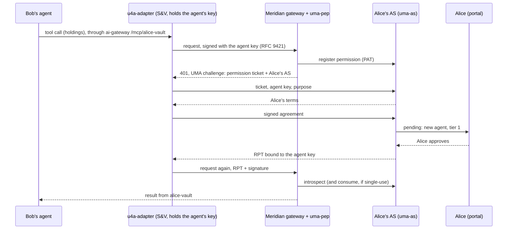

# Identity flows

The three ways an agent gets access in this lab, hop by hop from the token in
the browser to the call the tool receives.

| Flow | Question it answers | Demo card | Checks |
| --- | --- | --- | --- |
| [Delegation](#1-delegation-at-the-firms-gateway) | how does Bob's agent act for Bob on the firm's own tools? | [Bob](cards/bob.html) | `make bob-verify` |
| [Cross App Access](#2-cross-app-access-id-jag-to-a-saas) | how does it reach a SaaS the firm subscribes to, as Bob? | [Bob](cards/bob.html) | `make bob-verify` |
| [UMA for agents](#3-uma-for-agents-bob-to-alice) | how does it reach data owned by someone outside the firm, on their terms? | [Bob to Alice](cards/bob-to-alice.html) | `make alice-verify` |

Every flow checks two identities: the workload (the agent's SPIFFE ID, from
the mesh) and the user (Bob, from a token). Neither alone is enough. The
agent holds no credential of its own, whether model key, tool token or
cross-company token.

Every path enters through S&V's gateway, the only party that mints what a
tool accepts ([Why this shape](#why-this-shape)).

## Where the user's tokens come from

1. Bob opens `https://kagent.sterling.lab`. The kgateway edge runs the OIDC
   code flow against S&V's broker (realm `sterling-vance`, client `kagent`,
   `platform/60-kagent/edge-sso.yaml`) and keeps two cookies:
   - `BearerToken`: Bob's access token, audience `ai-gateway`. Claim `idp`
     names the session's IdP; `idp_acr`, `idp_amr` and `idp_auth_time`
     carry what that IdP asserted about the sign-in. The edge forwards it to
     kagent as `Authorization`.
   - `IdToken`: Bob's ID token, issued to `kagent`. It stays at the edge.
2. On each A2A turn the kagent controller passes the agent `Authorization`
   and nothing else of Bob's.
   - OSS kagent runs in trusted-proxy mode and takes the user from the
     forwarded token without checking its signature. The mesh therefore
     admits only the UI (which forwards what the edge verified) and the
     agents' worker pools
     ([ARCHITECTURE.md](ARCHITECTURE.md#what-the-lab-doesnt-enforce)).
   - kagent-enterprise verifies the token against S&V's broker itself
     ([ENTERPRISE.md](ENTERPRISE.md)).
3. The agent (`sv-agents/bob-assistant`, a SandboxAgent on Agent Substrate)
   forwards `Authorization` on every tool call (`KAGENT_PROPAGATE_TOKEN`).
   Its model calls carry the same token as their API key (ModelConfig
   `firm-llm`, `apiKeyPassthrough`). The model route logs whose turn a call
   serves, then removes the token, so no model provider sees it.

Only Cross App Access (section 2) needs Bob's ID token, and the egress
gateway gets it from S&V's broker, which vouches for Bob. The edge forwards
the access token because Keycloak's standard token exchange accepts only an
access token as subject.

## AI clients at S&V's front door

An AI client outside the mesh (Claude Code, an IDE, any MCP client) reaches
the firm's tools at the same gateway, through the edge
(`demos/bob/manifests/22-ai-clients.yaml`):

| URL | Reaches |
| --- | --- |
| `https://mcp.sterling.lab/mcp/bob-workspace` | Bob's workspace (section 1) |
| `https://mcp.sterling.lab/mcp/ledgerline` | Ledgerline Research (section 2) |

```mermaid
sequenceDiagram
  participant C as AI client (Bob's laptop)
  participant G as ai-gateway (via the edge)
  participant F as identity fabric (S&V's broker)
  participant I as S&V's primary IdP
  C->>G: initialize, no token
  G-->>C: 401, WWW-Authenticate: resource_metadata
  C->>G: protected-resource metadata, then authorization-server metadata
  G-->>C: authorization server: the gateway; authorize and token: the fabric; client: sv-mcp-client
  C->>F: authorize (PKCE, loopback redirect)
  F->>I: redirect to the IdP that is primary now
  I-->>F: Bob signed in
  F-->>C: code, then Bob's access token (aud ai-gateway)
  C->>G: tools/call, Authorization: Bob's access token
  G->>G: verify, client and groups, assurance gate, tool allowlist
  G->>G: mint the server its own token for this call (or an ID-JAG toward Ledgerline)
```

- **Sign-in redirects to the primary IdP.** A client with no token gets a
  401 pointing at the protected-resource metadata (agentgateway's MCP
  authorization, `traffic.jwtAuthentication.mcp`), which names the gateway
  as authorization server. The gateway's metadata sends authorize and token
  requests to the identity fabric, which redirects to whichever of S&V's
  IdPs is primary. After a failover the same URL lands at the next IdP.
- **No open registration.** Every client gets the one client S&V
  registered, `sv-mcp-client` (public, PKCE S256, loopback redirects only,
  no password grant).
- **The same checks as the firm's agents.** A fabric JWT with audience
  `ai-gateway`, through the edge, from `sv-mcp-client`, for a user in
  `advisors`; the same assurance rules (`advisor-workspace`,
  `ledgerline-research`) and per-tool allowlist. The server gets a token
  minted for that call alone, or Ledgerline an ID-JAG made for it; Bob's
  token never leaves S&V.
- **Ledgerline has no door of its own for S&V's users.** It refuses S&V's
  token at `mcp.ledgerline.lab`; S&V's users reach it only through S&V's
  gateway, which Ledgerline trusts.

## 1. Delegation at the firm's gateway

Every S&V MCP server sits behind `ai-gateway` (`agentgateway-system`), the
firm's one gateway, which also fronts models and Cross App Access. It
decides who may call which tool. An MCP server that takes a token accepts
only one the gateway minted.

| Path on `http://ai-gateway.agentgateway-system.svc.cluster.local` | MCP server | Caller (workload, acting for) | Upstream gets |
| --- | --- | --- | --- |
| `/mcp/bob-workspace` | `sv-mcp/bob-workspace` | `sv-agents` `bob-assistant` or `advisor-desk`, for a user in `advisors` | a token for the workspace alone |
| `/mcp/kagent-tools` | `kagent/kagent-tools` (the ops agents' tools) | `kagent/kagent-ops`, for a user in `platform-admins` | no token |
| `/mcp/alice-vault` | `sv-u4a/u4a-adapter` (section 3) | `sv-agents/bob-assistant`, for a user in `advisors` | no token (the adapter signs with its own key) |
| `/xaa/ledgerline/mcp` | Ledgerline (section 2) | the agents' worker pools | an ID-JAG, then Ledgerline's token |

AI clients outside the mesh reach the same servers at
`https://mcp.sterling.lab/mcp/<name>` ([front
door](#ai-clients-at-svs-front-door)).

Each S&V path has a user lane and a discovery lane (below), and lets
through only the tools its agents are given. For `/mcp/kagent-tools` those
are the tools the ops agents name, computed at install.

The gateway finds each server by its Service's `lab.solo.io/mcp` label and
reaches it over the mesh as itself. The mesh lets only the gateway's
identity (`cluster.local/ns/agentgateway-system/sa/ai-gateway`) reach each
server (`pods-only-from-gateway` in `sv-mcp`, `kagent-tools-callers` in
`kagent`, `adapter-callers` in `sv-u4a`).

The ops agents forward the signed-in user's token
(`KAGENT_PROPAGATE_TOKEN`). kagent-tools runs as its own release, and the
ops agents' tool server (`kagent-tool-server`) is the gateway's path to it
(layer 60). Each server gets its own path instead of kagent's proxy
setting because the kagent controller lists tools by dialing each server, so agents
and tool discovery share one front door.

Bob's workspace (`sv-mcp/bob-workspace`, a kmcp server) never sees Bob's
token. The gateway verifies Bob and the agent, then mints the workspace a
short-lived token for Bob for that call alone, never cached for reuse.

In RFC 8693's terms the swap is *impersonation* rather than delegation. The
gateway sends only a subject token (Bob's), so the new token names Bob and
has no `act` claim for the agent. The mesh establishes which agent is
calling (the worker pool's SPIFFE ID, checked at the gateway); the token
doesn't record it. Keycloak's standard token exchange doesn't take an actor
token yet; with one, the token would carry `act: {sub: <agent>}`.

```mermaid
sequenceDiagram
  participant A as Bob's agent (sv-agents)
  participant G as ai-gateway (agentgateway, agentgateway-system)
  participant S as agentgateway STS (Enterprise) or S&V broker (OSS)
  participant T as bob-workspace
  A->>G: tools/call /mcp/bob-workspace, Authorization: Bob's access token (HBONE, SPIFFE ID of the agent)
  G->>G: verify JWT (aud ai-gateway), caller is an agent's pool, Bob in advisors, tool allowed
  G->>G: assurance gate: does Bob's sign-in meet advisor-workspace's assurance rules?
  G->>G: relationship guard (OpenFGA): does the agent act for Bob, may he call the workspace, which clients may he see?
  G->>S: token exchange, subject = Bob's token, audience bob-workspace
  S-->>G: token for Bob, aud bob-workspace, seconds to live
  G->>T: tools/call, Authorization: the minted token (Bob's own token removed)
  T->>S: JWKS (cached; on Enterprise through ai-gateway's /sts/jwks.json): verify the minted token's signature, issuer, audience, expiry
  T-->>A: result, acting for bob (through mcp-guard)
```

- **Path.** The agent calls
  `http://ai-gateway.agentgateway-system.svc.cluster.local/mcp/bob-workspace`.
- **User lane** (a bearer token is present), all in
  `demos/bob/manifests/20-front-door.yaml`:
  - JWT, strict: issuer `https://idp.sterling.lab/realms/sterling-vance`,
    audience `ai-gateway`.
  - Authorization: the caller is an agent's worker pool, named by
    ServiceAccount (`bob-assistant` or `advisor-desk` in `sv-agents`), and
    `"advisors" in jwt.groups`. Another workload in `sv-agents` holding
    Bob's token is refused.
  - Per-tool CEL: advisors get `whoami`, `list_clients`, `get_client`,
    `get_meeting_notes`, `log_followup`. `export_book` needs group
    `compliance`, which no lab user is in; to try it, add one to
    `compliance` at the broker (realm `sterling-vance`). A tool the caller
    may not use is removed from `tools/list`, so the agent is never shown it.
  - Workload profile `advisor-workspace` (Critical, AAL2). Before anything
    is minted, the same policy sends the verified token's sign-in claims to
    the rule check (Solo's ext-auth service, `entExtAuth`, on Enterprise;
    the assurance gate, `extAuth`, on OSS; both fail closed). It answers
    401 with an RFC 9470 challenge when a stronger sign-in at the IdP would
    pass, and 403 when the profile doesn't take sessions from that IdP
    ([IDENTITY-CONTINUITY.md](IDENTITY-CONTINUITY.md#where-the-rules-are-decided)).
  - Relationships. On every `tools/call`, `relationship-guard`
    (`apps/relationship-guard`, the first of the backend's MCP guardrails,
    ExtMCP, `FailClosed`) asks S&V's OpenFGA whether the agent acts for Bob,
    whether Bob may call `bob-workspace`, and which clients he may see. Bob's
    groups go in as contextual tuples from the verified token. The gateway
    hands the workspace the client list (`x-relationship-clients`); the
    workspace shows only those, and refuses the call without it
    ([IDENTITY-CONTINUITY.md](IDENTITY-CONTINUITY.md#relationships)).
  - Backend auth: `oauthTokenExchange` with subject
    `jwt.rawToken.unredacted()`, audience `bob-workspace`
    (`mcp_exchange` in `scripts/idp.sh`).
    - Enterprise: agentgateway's STS (`enterprise-agentgateway:7777`) mints
      it, issuer the STS, for `MCP_TOKEN_LIFETIME` (5 s). Only the
      ai-gateway may mint there (mesh policy `sts-callers`). MCP servers
      read its keys through the gateway (`/sts/jwks.json`,
      `platform/40-agentgateway/sts.yaml`).
    - OSS: an RFC 8693 exchange at S&V's broker as client `ai-gateway`
      (confidential, standard token exchange; secret
      `agentgateway-system/ai-gateway-oidc`), for the same
      `MCP_TOKEN_LIFETIME`.
  - The workspace verifies that token itself before any tool runs
    (signature against the issuer's JWKS, issuer `MCP_TOKEN_ISSUER` in
    `config/lab.env`, audience `bob-workspace`, expiry). Bob's own token,
    or a forged or replayed one, is refused even if something reached the
    pod.
  - Tool output: every `tools/call` result goes through `mcp-guard`
    (`apps/mcp-guard`, an agentgateway MCP guardrail, ExtMCP over gRPC, in
    `agentgateway-system`) before the agent sees it. It masks account
    numbers (runs of 8 to 17 digits) and SSNs in the result's text and
    `structuredContent` to their last four (`••••8265`). It logs the tool
    and how many values it masked, never the values. With
    `failureMode: FailClosed` and a 5 s deadline, no answer from the guard
    means no result. Only the ai-gateway can reach it
    (`demos/bob/manifests/25-mcp-guard.yaml`).
- **Discovery lane** (no token): only the kagent controller's SPIFFE ID, and
  only `tools/list` (`mcp.methodName`), so the UI can list tools. Same tool
  filter, no token minted. The route strips `Authorization` and
  `X-Id-Token`, so no credential reaches the workspace on it.
- **Writes wait for Bob.** `log_followup` is in the agent's
  `requireApproval`, so the agent pauses for his approval in the chat. The
  entry records the user (`bob`) and the party that carried it out (the
  token's `azp`).

Checks (`make bob-verify`, from real pods with their own identities):

| Case | Expected |
| --- | --- |
| an S&V agent workload with Bob's token lists tools, calls `whoami`, `list_clients` | allowed; `acting_for: bob`, `audience: bob-workspace` |
| `get_client` for a client with an account number | the record, account number masked to its last four by the gateway's guardrail |
| `export_book` as an advisor | not in the list; refused |
| an S&V agent workload with no user token | refused (discovery lane is controller-only) |
| Bob's token from another namespace (`observability`) | refused |
| Bob's token from a workload in `sv-agents` that isn't an agent's pool | refused |
| Bob's token sent straight to the workspace's Service, or a pod IP | refused (the pods only accept the gateway) |
| an ops agent's worker, for a user not in `platform-admins`, or with no user token, at `/mcp/kagent-tools` | refused |
| an ops agent's worker straight to kagent-tools | refused (only the gateway) |
| the kagent controller, no user, at `/mcp/kagent-tools` | lists the ops tools; a tool call is refused |
| the agent, or the workspace, asks the STS for a workspace token with Bob's token (Enterprise) | refused (only the gateway reaches the STS) |
| Bob's sign-in at S&V's own Keycloak (password and one-time code) | allowed: AAL2 meets `advisor-workspace` |
| S&V's own Keycloak cut, Bob's new sign-in at the contingency IdP (password only) | refused: 401 `insufficient_user_authentication`, AAL1 below AAL2 |
| his AAL2 session from before the outage | allowed (the profile takes any allowed IdP's sessions) |

## 2. Cross App Access (ID-JAG) to a SaaS

Ledgerline Research is a SaaS S&V subscribes to, a separate company with its
own authorization server. Bob's agent uses it as Bob, with no consent screen
and no shared credential. On every call, S&V's identity fabric vouches for
Bob to Ledgerline for one approved connection with a fresh ID-JAG, living
`MCP_TOKEN_LIFETIME` (5 s) when the broker issues it. Ledgerline then issues
its own token, which lives no longer than that vouch and has no refresh
token.

Every exchange happens at the firm's gateway. The agent holds only Bob's
S&V access token, never an ID token, the ID-JAG or Ledgerline's token. The
ID-JAG covers only the gateway-to-SaaS hop; sign-in never uses one.

Three settings in `config/lab.env` (`scripts/idp.sh`):

| Setting | Values | Decides |
| --- | --- | --- |
| `ENTERPRISE_IDP` | `auth0,keycloak,contingency` (default), `gluu,auth0,keycloak,contingency`, `okta,keycloak`, ...; any order | S&V's IdPs, which sign Bob in, in failover order ([IDENTITY-CONTINUITY.md](IDENTITY-CONTINUITY.md)); `keycloak` is the Keycloak S&V runs itself (`https://login.sterling.lab`) |
| `RESOURCE_AS` | `keycloak` (default), `gluu`, any name with `LEDGERLINE_<NAME>_ISSUER` | Ledgerline's authorization server |
| `XAA_VOUCHER` | `broker` (default), or an IdP in `ENTERPRISE_IDP` that issues ID-JAGs (`gluu`) | who vouches for Bob to Ledgerline (issues the ID-JAG) |

Each is configured by name ([IDPS.md](IDPS.md)).

By default (`XAA_VOUCHER=broker`) S&V's broker vouches for every S&V user,
whichever IdP signed them in. Ledgerline trusts that one issuer and never
learns S&V's IdP chain. The ID-JAG's `sub` is Bob's broker account, the
same across failover.

| Bob's session | Vouches |
| --- | --- |
| any IdP in the chain (Gluu, Okta, Auth0, S&V's own Keycloak, ...), while it is S&V's active IdP | S&V's broker |
| the broker's break-glass accounts (platform admins) | S&V's broker |
| an IdP that is no longer active (failed over, drained) | nobody: refused until Bob signs in again |

With `XAA_VOUCHER=<idp>` the user's own IdP vouches instead, from the ID
token it issued for Bob's sign-in. Ledgerline's AS trusts that IdP, and
the ID-JAG's `sub` is Bob's account there.

| Bob's session | Vouches |
| --- | --- |
| signed in through the voucher, while it is S&V's active IdP | the voucher, from its own ID token |
| any other IdP in the chain, or break-glass | nobody: there is no ID token from the voucher to exchange |

The broker issues no ID-JAG in this mode. It keeps the voucher's ID token
from Bob's sign-in and releases it only to `kagent`, for Bob's live session
from that IdP (`continuity-upstream`,
[tools/keycloak-idjag](../tools/keycloak-idjag/README.md)). Ledgerline's
access token still comes from Ledgerline's own AS.

Failover is the continuity controller's decision alone (`status.active`).
An inactive upstream is disabled at the broker (no sign-in, even by hint),
and every call to an upstream leaves through `sv-egress`, where one cut
stops them all
([IDENTITY-CONTINUITY.md](IDENTITY-CONTINUITY.md#the-resource)). When the
broker vouches, Cross App Access calls no upstream; the broker vouches from
Bob's session. When an IdP vouches, the gateway's request to it leaves
through `sv-egress` like every other call to an upstream. With a fresh
ID-JAG and Ledgerline token per call, a refusal takes effect on the next
call.

```mermaid
sequenceDiagram
  participant A as Bob's agent
  participant G as ai-gateway (S&V egress)
  participant X as idtoken-exchange (ext_proc)
  participant K as S&V broker (Keycloak)
  participant L as Ledgerline AS (Keycloak or Gluu)
  participant M as ledgerline-research (behind Ledgerline's MCP gateway)
  A->>G: tools/call /xaa/ledgerline/mcp, Authorization: Bob's access token
  G->>G: verify JWT (aud ai-gateway), caller is an agent's pool, Bob in advisors; assurance gate
  G->>X: request headers, verified token as metadata
  X->>K: token exchange (RFC 8693) as kagent: Bob's ID token
  X-->>G: x-id-token (replaces any the caller sent)
  G->>G: IdP leg (/xaa-legs/ledgerline/idp/token): verify the ID token, only this exchange, audience and scopes
  G->>K: token exchange: subject = Bob's ID token, requested type ID-JAG, as kagent
  K-->>G: ID-JAG for Bob's broker account, for this connection only
  G->>G: Ledgerline leg (/xaa-legs/ledgerline/as/token): verify the ID-JAG against the broker, typ, client_id, lifetime, scopes
  G->>L: JWT authorization grant (RFC 7523), scope research:read, private_key_jwt as sterling-vance-kagent
  L-->>G: Ledgerline access token for Ledgerline's Bob, aud ledgerline-research, scope research:read
  G->>M: via the edge (TLS), Authorization: Ledgerline's token
  M-->>A: result
```

- **Requesting side** (`demos/bob/manifests/xaa/`): agentgateway makes and
  checks every token request; the lab adds only `idtoken-exchange`.
  - Route `xaa-ledgerline` on ai-gateway, matched only with a bearer token,
    to backend `xaa-ledgerline`.
  - JWT, strict, audience `ai-gateway`. Authorization: the caller is an
    agent's worker pool (by ServiceAccount) and `"advisors" in jwt.groups`.
  - Workload profile `ledgerline-research` (High, AAL2, sessions from the
    active IdP only). The assurance gate decides before the ID token is
    fetched or an ID-JAG requested, so a session that is too weak, or from
    an IdP the chain has moved off, never reaches Ledgerline.
  - External processor `idtoken-exchange` (`apps/idtoken-exchange`, gRPC
    ext_proc): request headers only, fail closed, the verified token passed
    as metadata (`jwt.rawToken`), never read from a header the caller sets.
    It sets `x-id-token`, replacing any value the caller sent, or answers 403
    (refused) or 503. Only ai-gateway may call it (mesh policy).
    - Why a separate processor: kagent passes agents only the access token,
      on either edition. agentgateway's `oauthTokenExchange` requires
      `token_type: Bearer` in the response, but RFC 8693 (2.2.1) has the IdP
      return `N_A` for an ID token.
    - It gets Bob's ID token from S&V's broker by RFC 8693, as `kagent`
      (`subject_token` = the access token, `requested_token_type` = ID
      token). The broker issues it only for a live session of that user and
      client, so the ID token belongs to the same sign-in. Each replica
      keeps it until the earlier of the two tokens' expiries; nothing is
      shared between replicas.
    - With `XAA_VOUCHER=<idp>` it then asks the broker for that IdP's ID
      token from the same sign-in (`POST
      /realms/sterling-vance/continuity-upstream/<idp>/id-token`, as
      `kagent`, `token` = the access token) and sets that instead. A
      session from any other IdP is refused (403).
  - Backend auth `crossAppAccess` on backend `xaa-ledgerline`
    (`xaa/ledgerline.yaml`, applied by `xaa_gateway_apply` in
    `scripts/idp.sh`): subject from header `x-id-token`, type ID token;
    audience Ledgerline's AS issuer; scopes `xaa-ledgerline research:read`
    for the ID-JAG and `research:read` for Ledgerline's token; no cache
    (`maxEntries: 0`), so each call asks for both again. S&V
    authenticates at the broker as `kagent` (its client secret), and at
    Ledgerline's AS with `private_key_jwt` (client `sterling-vance-kagent`,
    assertion audience the AS's issuer, key `.lab/keys/sv-xaa-client.key`).
    Only the gateway holds those credentials. With `XAA_VOUCHER=<idp>`
    the ID-JAG is requested at that IdP's token endpoint as S&V's client
    there (`<IDP>_CLIENT_ID`), with `private_key_jwt` signed by the broker's
    PS256 key (Secret `xaa-idp-client-key`), scope `research:read` and
    `resource` Ledgerline's MCP server (RFC 8707).
  - Both token requests go out through ai-gateway's own routes, so its
    policies apply to them. Only ai-gateway may call these routes.
    - IdP leg, `/xaa-legs/ledgerline/idp/token` (route and policy
      `xaa-idp`): the subject token is verified against the voucher's keys
      (the broker: issuer, audience `kagent`; an IdP: its issuer, audience
      S&V's client there, keys from its `jwks_uri`). Only a token exchange
      for an ID-JAG for Ledgerline's AS, within the connection's scopes and
      for Ledgerline's MCP server if a `resource` is named, goes out.
    - Ledgerline leg, `/xaa-legs/ledgerline/as/token` (route and policy
      `xaa-as-ledgerline`): the ID-JAG in the grant is verified against
      the voucher, the only issuer it trusts (signature, `iss`, `aud` =
      Ledgerline's AS, `exp`, `sub`). Then `typ` `oauth-id-jag+jwt`,
      `client_id` = S&V's client at Ledgerline's AS, a lifetime of at most
      `MCP_TOKEN_LIFETIME` (broker) or 300 s (an IdP, which sets its own),
      and scopes within the connection's and `openid profile email`. A
      refusal fails the call.
    - Both legs are in ai-gateway's access log with the verified claims,
      never the tokens (`make xaa-logs`).
  - The agent's tool (`RemoteMCPServer ledgerline-research`) points at
    `ai-gateway/xaa/ledgerline/mcp`.
- **S&V's clients and keys** (realm `sterling-vance`):

  | Client | Holds | May |
  | --- | --- | --- |
  | `kagent` (secret: the edge and the egress, one application) | none | SSO for kagent; RFC 8693 (access token to ID token); request the ID-JAG with optional scope `xaa-ledgerline`. Keycloak issues an ID-JAG only for an ID token of the app the user signed into. No full scope, no offline tokens |
  | broker key (PS256 realm key, client assertions only) | Keycloak | authenticate S&V's broker to upstream IdPs |

  Scope `xaa-ledgerline` adds `client_id=sterling-vance-kagent` and
  Ledgerline's AS issuer as audience; the connection exists because the
  firm approved this scope for this client. The broker's client for
  Ledgerline's AS sets how long the broker vouches to it
  (`access.token.lifespan` = `MCP_TOKEN_LIFETIME`), and no ID-JAG for it
  lives longer. `make xaa-keys` writes the public keys other parties
  register.
- **Resource AS**, Ledgerline's own Keycloak (`RESOURCE_AS=keycloak`, realm
  `ledgerline`, feature `identity-assertion-jwt`,
  `demos/bob/ledgerline/realm-ledgerline.json`):
  - One identity provider, `sterling-vance` (S&V's broker). It accepts
    ID-JAGs (assertion reuse off, at most 300 s) and is Ledgerline's SSO for
    S&V (client `ledgerline` there, `private_key_jwt` with Ledgerline's own
    PS256 key, PKCE). It is trusted for S&V's domain only (`email` must end
    in `@sterling.lab`).
  - Bob's Ledgerline account is linked to his broker account, the `sub` of
    the broker's ID-JAGs whichever IdP signed him in. The lab provisions
    that link. Another S&V user's first sign-in to Ledgerline through the
    broker makes theirs (flow `enterprise first sign-in`: a new account
    named by its verified email, or the existing seat with that email).
  - Client `sterling-vance-kagent` may use the JWT authorization grant with
    that identity provider and authenticates with `private_key_jwt` (S&V's
    certificate and `kid`, no secret). It gets scope `research:read`
    (audience `ledgerline-research`) only when it asks, and no full scope.
    Its token lives `MCP_TOKEN_LIFETIME` with no refresh token.
  - Ledgerline's services reach the internet only through Ledgerline's
    egress waypoint (`ledgerline-egress`, one ServiceEntry per host). With
    an AS outside the lab, that is how the MCP server gets the AS's keys.
- **Resource AS** outside the lab (e.g. `RESOURCE_AS=gluu`, at
  `LEDGERLINE_GLUU_ISSUER`): it trusts the voucher as its ID-JAG issuer:
  S&V's broker by its published keys (`sv-idp.jwks.json`; the broker's
  issuer isn't reachable from the internet), or with `XAA_VOUCHER=<idp>`
  that IdP by its `jwks_uri`. It registers S&V's client key
  (`make xaa-keys`;
  [IDPS.md](IDPS.md#ledgerlines-authorization-server)).
- **Resource server** (`demos/bob/ledgerline/research.yaml`): Ledgerline's
  own agentgateway (`mcp-gateway`) in front of its MCP server, reached only
  from the edge. Without a token from Ledgerline's AS (audience
  `ledgerline-research`) it answers 401 and lists nothing. With one, it
  decides per tool: any Ledgerline token may list the tools,
  `sector_outlook` and `research_note` need scope `research:read`, and
  `account_info` needs a signed-in subject. A method header that disagrees
  with the request is refused.
  The server verifies the token again (signature, issuer, audience, scope,
  a registered client) before any tool runs, and records any ID token that
  reaches it.
- **No lane without a user.** Ledgerline has no discovery lane; its tools
  are listed only on a user's call, with that call's Ledgerline token.

Checks (`make bob-verify`). The run signs Bob in through S&V's own Keycloak
by draining the IdPs ahead of it, then restores the chain on exit; the
Observatory shows the transitions.

| Case | Expected |
| --- | --- |
| `account_info` with Bob's access token from an S&V agent workload | Ledgerline's own account for Bob |
| the ID-JAG ai-gateway verified | from S&V's broker, `aud` Ledgerline's AS, `client_id` S&V's client there |
| its lifetime | at most `MCP_TOKEN_LIFETIME` |
| three calls in a row | three different ID-JAGs, none reused |
| the token Ledgerline issued for it | lives no longer than the ID-JAG, no refresh token |
| an agent workload calling the gateway's Ledgerline leg directly | refused |
| `sector_outlook` through XAA | result |
| another user's ID token in `x-id-token` | replaced: still Bob's Ledgerline account |
| what Ledgerline received | never an ID token |
| right token, wrong workload (`observability`) | refused |
| an agent workload calling `idtoken-exchange` directly | refused by the mesh |
| Bob's S&V token sent straight to `mcp.ledgerline.lab` | refused by Ledgerline |
| Ledgerline's tool list, no token | 401, nothing listed |
| a research call with no Ledgerline token | 401 at Ledgerline's MCP gateway |
| Bob asks his agent, in chat, which Ledgerline account he's using | Ledgerline's own account for Bob |

Checks for AI clients at the front door (`make bob-verify`, from a pod
outside S&V, through the edge):

| Case | Expected |
| --- | --- |
| no token | 401 with `resource_metadata` |
| the protected-resource metadata | names the gateway as authorization server |
| Bob signed in as `sv-mcp-client`, `whoami` on Bob's workspace | `acting_for: bob`, issuer the gateway's minter |
| `export_book` | refused |
| Bob's kagent token (another client) | refused |
| Dana (not in `advisors`) | refused |
| `account_info` at `/mcp/ledgerline` | Ledgerline's own account for Bob, through S&V's gateway |

## 3. UMA for agents (Bob to Alice)

Meridian Wealth, Alice's brokerage, holds her portfolio, but the data is
hers: neither Bob's firm nor Meridian decides who reads it. Her own
authorization server (UMA 2.0) holds her terms, and Meridian's gateway asks
it on every call. Bob's agent has to earn a grant on her terms, bound to a
key only it holds.

The protocol profile, its services and their tests are in
[uma4agents](https://github.com/nickgamb/uma4agents) (`docs/PROTOCOL.md`,
`docs/ARCHITECTURE.md`). This lab runs those services as separate parties
behind the mesh, built from that repository at `U4A_TAG`
(`demos/bob-to-alice/install.sh`).



- **Parties** (`demos/bob-to-alice`):
  - S&V: `sv-u4a/u4a-adapter`, the UMA client. It holds the agent's Ed25519
    key (a fresh one per pod, so the agent is pseudonymous to Alice) and runs
    ticket, terms, agreement, and RPT for the agent. Only the ai-gateway can
    reach it (`/mcp/alice-vault`, section 1), for Bob's agent acting for an
    advisor and for the kagent controller listing tools. The advisor's
    token stops at the gateway. The adapter agrees to Alice's terms for the
    agent on its own, within `UMA4A_STANDING_MAX_EXPIRES` (7 days). No
    person at S&V signs each agreement, and the adapter doesn't know which
    user a call is for
    ([ARCHITECTURE.md](ARCHITECTURE.md#what-the-lab-doesnt-enforce)).
  - Meridian: its gateway (agentgateway), `uma-pep` (ext-auth: challenges,
    introspection, proof-of-possession checks, tool-to-resource scoping,
    single-use consumption) and `alice-vault` (a stock MCP server with no
    auth code). The gateway is reachable from the edge only; the vault from
    the gateway and Alice's portal only.
  - Alice: `alice/uma-as` (her authorization server and its Postgres, run by
    CloudNativePG), `alice/portal`, and her IdP (`alice-identity`, realm
    `alice`). Her grant surface is reachable through the edge only; her owner
    API only from her portal, or with her own token.
- **Every cross-party hop crosses the edge**, as separate companies meet on
  the internet: adapter to Meridian, Meridian to Alice's AS, adapter to
  Alice's AS.
- **Her terms, by tier:**

| Tier | Resource | Her default | What the agent gets |
| --- | --- | --- | --- |
| 1 | holdings | approve on first contact, then standing | a grant covered by her terms |
| 2 | transactions | approve once per tier | the same, for this tier |
| 3 | trades | ask me, every time | a single-use grant for that one operation |

  An agent with no standing connection is held on first contact whatever the
  tier. Revoking the agent in her portal kills every token it holds; its next
  request starts over as a stranger.
- **Proof of possession.** An RPT is bound to the agent's key, and every
  request is signed (RFC 9421). A copied RPT is useless without the key.
- **What stays where.** Meridian enforces Alice's terms without reading them.
  S&V never sees Alice's credentials, and Alice never needs to know how S&V
  identifies its agent.

Checks (`make alice-verify`):

| Case | Expected |
| --- | --- |
| tier 1, first contact | held for Alice; approved; holdings returned |
| tier 2 | held at the new tier, approved, history returned; asked again, it goes through on her standing terms |
| tier 3 trade | held; Alice denies; nothing executed |
| a call to Meridian with no grant | 401 with a UMA challenge |
| Alice's owner API without her token | refused |
| Bob's agent's adapter, skipping the firm's gateway | refused (mesh) |
| another S&V workload using Bob's agent's adapter at the gateway | refused |
| the kagent controller, no user, calling the vault at the gateway | refused (it may only list) |
| straight to Alice's vault, skipping Meridian's gateway | refused (mesh) |
| straight to Alice's AS, skipping the edge | refused (mesh) |

`make reset` clears Alice's grants, ledger and terms, and gives the adapter a
new agent key, so the next run starts as a first contact.

## Why this shape

- **One door.** Every agent and AI client reaches every tool, the firm's
  or a SaaS's, through S&V's gateway, so policy, assurance, guardrails and
  logs live there instead of in each tool.
- **Per call.** What a tool accepts is minted for one call (5 s) and never
  cached, and every SaaS call gets a fresh ID-JAG. An agent that drifts
  past its allowed call has nothing to reuse and must come back to the
  gateway, which can refuse. The common pattern caches an exchanged token
  for its whole lifetime, or hands the agent a session-long token.
- **The agent never holds a token a tool accepts.** It holds Bob's access
  token, which no MCP server and no SaaS takes. The usual delegation hands
  the agent the downstream token itself.
- **One issuer, however many IdPs.** Resource servers and SaaS trust the
  fabric alone. S&V's IdPs don't know each other or the resources, and a
  failover changes nothing downstream. ID-JAG as usually drawn has each IdP
  issue its own, so every SaaS trusts every IdP in the estate.
- **A SaaS token no longer than the vouch.** Ledgerline's token lives as
  long as its ID-JAG, with no refresh token, so it can't outlive S&V's
  decision.
- **Standards where the resource is.** MCP servers and the SaaS see OAuth
  tokens and RFC 7523 grants they already understand; the new parts live at
  the gateway.

## Patches these flows need

| Patch | Needed for | Why |
| --- | --- | --- |
| `tools/kagent` 0001 | all three | Substrate actors call the kagent controller back with the caller's credential (they have no ServiceAccount token) |
| `tools/kagent` 0002 | writes that wait for approval, UMA holds | a turn sent as the last one closes (after a human approval) no longer races the actor's suspend (OSS controller) |
| `tools/substrate-mesh` 0001, 0002 | all three | a worker pool runs as its agent's ServiceAccount, so the agent's calls carry that SPIFFE ID (which the ai-gateway checks), and only serves its own namespace |
| `tools/substrate-mesh` 0003 | all three | actors work under the mesh's in-pod traffic capture |
| `tools/keycloak-idjag` 0001 | Cross App Access | ID-JAG issuing (keycloak/keycloak#49998) |
| `tools/keycloak-idjag` 0002 | Cross App Access | the client for an ID-JAG's audience may hold it shorter: how long the issuer vouches to that authorization server |

## Seeing them in the Observatory

- **Topology, Identity view:** the IdPs, SSO links, token-exchange hops and
  gateways that check tokens, with each agent's path to its tools.
- **Traffic, Carries a token:** each request's verified claims at the gateway
  that checked them. At `ai-gateway` that is Bob's access token (issuer,
  audience, groups, expiry). Tokens it mints for MCP servers are minted
  after the log point and aren't shown.
