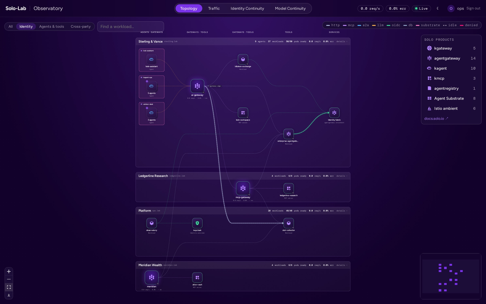
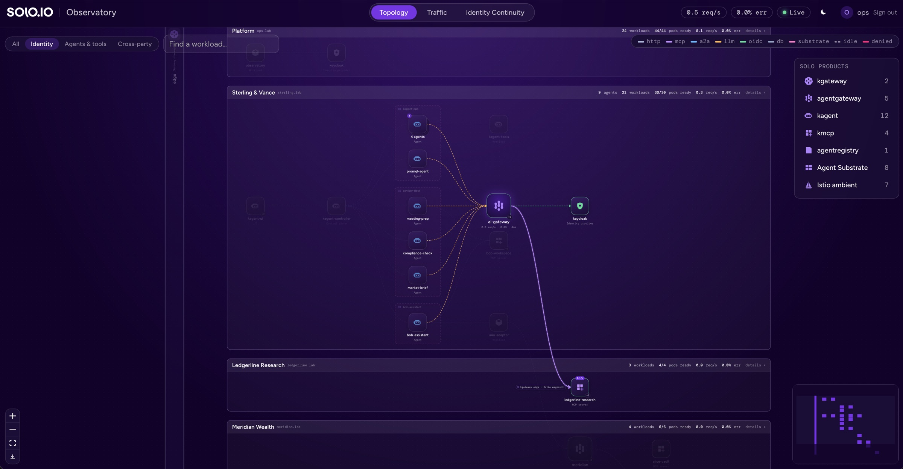
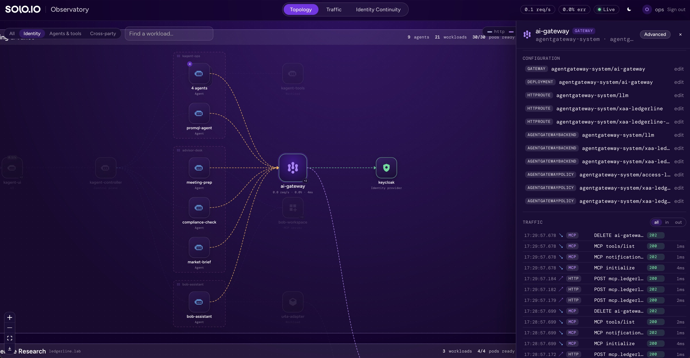
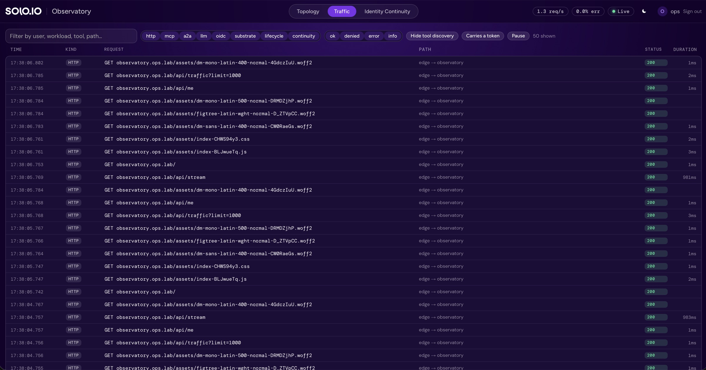
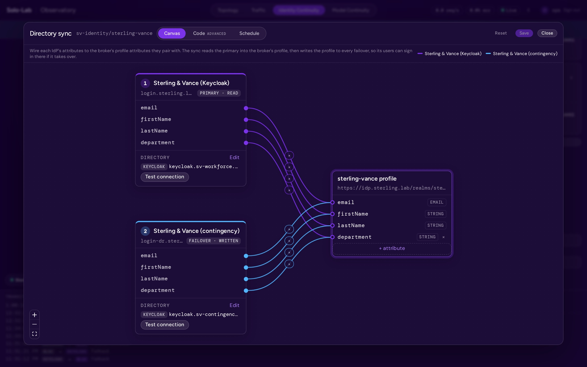
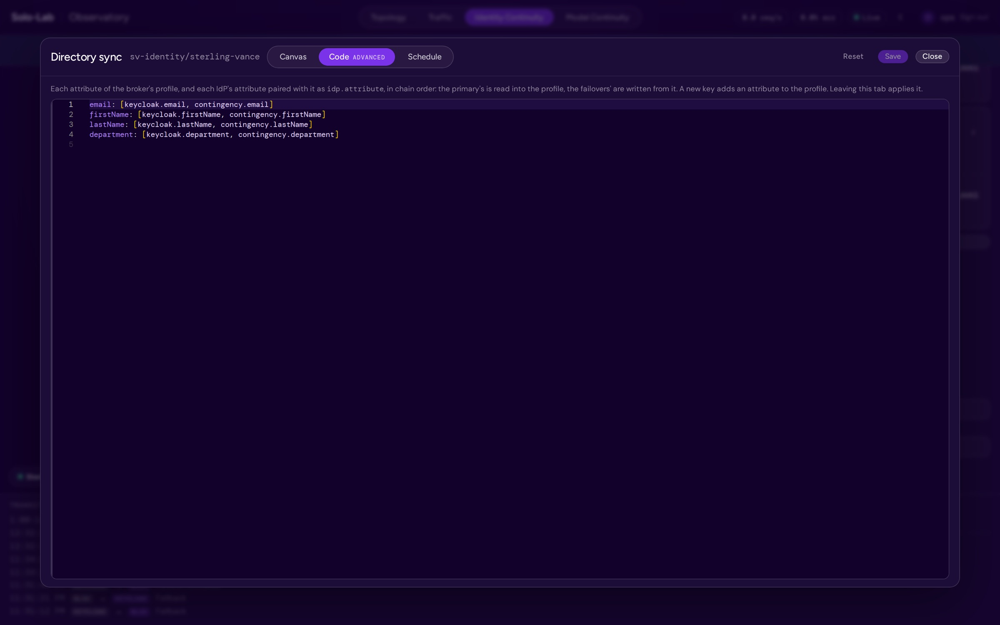
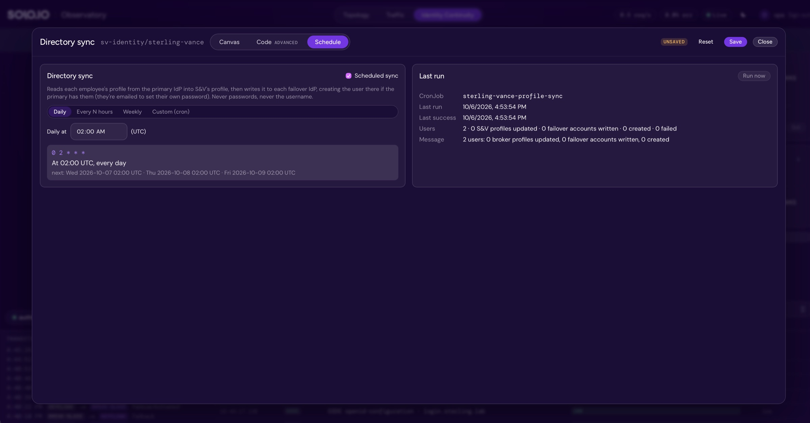
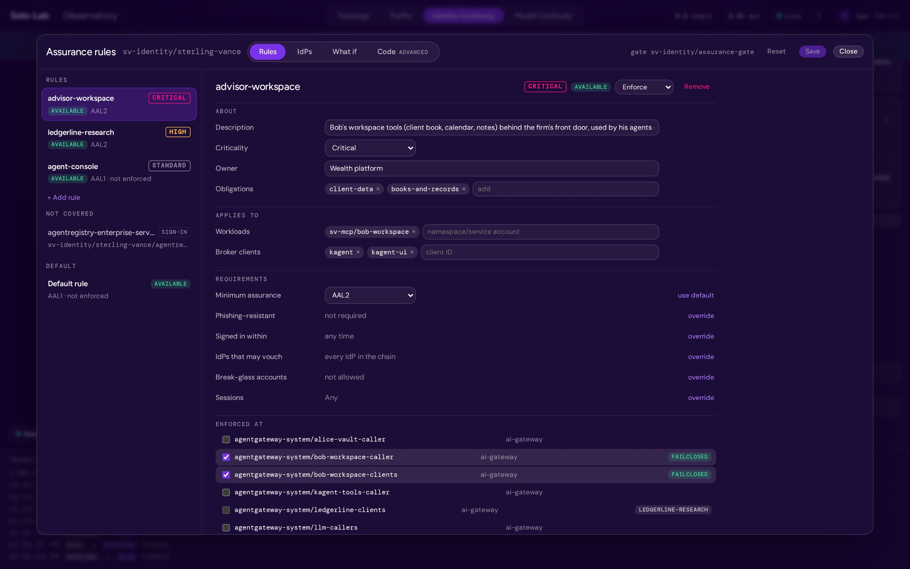
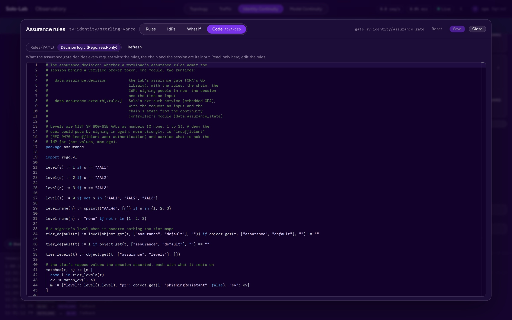
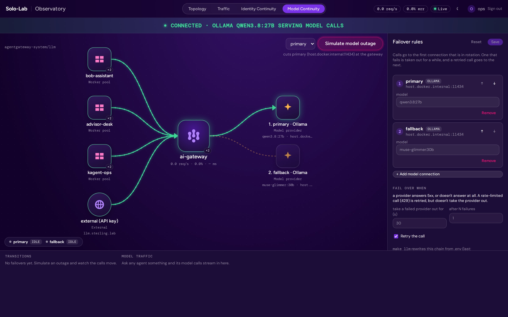

# Solo-Lab Observatory

A live view of the lab for platform admins: what runs where, what calls what,
each call's traffic, and the sign-in chain. It reads the cluster at runtime
and assumes none of this lab's names, so any cluster renders the same way.

Source: `apps/observatory` (Go server in `server/`, React UI in `web/`).
Install: `platform/90-observatory` (`make layer-90`). Lab code, not a Solo
product.

## Seeing it work

[](https://youtu.be/Y3P4a7HRvVs)

A three-minute walkthrough, [on YouTube](https://youtu.be/Y3P4a7HRvVs).

`make tour` drives every story end to end with real traffic, scene by scene,
and prints where to look. The presenter's script is the
[Observatory demo card](cards/observatory.html).

## Access

`https://observatory.ops.lab`, user `ops` / `ops-demo`.

Sign-in uses the Observatory's own Keycloak (namespace `ops-identity`, realm
`ops`), separate from the parties' IdPs. The edge runs the OAuth2 flow
(`GatewayExtension observatory-sso`); the server re-verifies the token
([Access model](#access-model)).

## Tabs

### Topology

Every workload as a layered diagram, read left to right.



| Element | Meaning |
| --- | --- |
| Lane | a zone (party): namespaces sharing the party label; its top bar shows live status |
| Column | a call stage, callers left of what they call; headings name what each stage mostly holds |
| Front door (left pillar) | the internet-facing kgateway; each zone's entry is a line out of it |
| Outside the lab (right column) | model providers and external services |
| Tray | an Agent Substrate worker pool around its agents; lit bays are busy workers |
| Wire | a call: colour is protocol, thickness traffic, moving dots traffic in the last window; dashed grey is configured but idle |
| Badge on a wire | a hop the call passes through (a waypoint, the edge, the Substrate router) |
| Stack ("4 agents") | look-alike nodes sharing neighbours; open it to list or unfold them |

Interactions:

- Hover a node: it, its neighbours and its pool stay lit.

  

- Click a node: summary, tools, pods, mesh identity, connections,
  configuration, and that node's traffic. **Advanced** opens the object's
  live YAML; Apply dry-runs it server-side, shows the diff, and applies it as
  you. If the object changed since loading, or another manager (a controller,
  Helm) owns a changed field, Apply stops and says so; **Apply anyway** takes
  the fields over. Policy, routing and identity continuity are editable;
  workloads, agents, gateway parameters, ConfigMaps (but the assurance
  decision logic's), RBAC and Secrets are read-only.

  

- Click a zone's status bar: every workload in the zone by kind, including
  idle ones the map folds away.
- Hover a wire: what it stands for, its rates and recent calls.
- Views (top left), each with its own layout: All; Identity (IdPs, SSO,
  token exchange, gateways that check tokens, where each agent's token goes);
  Agents & tools (agents, gateways, MCP servers, models); Cross-party (calls
  that cross a zone).
- Product rail (right): hover or pin a Solo product to light every instance
  (tiles, wire badges, Substrate trays, and a count on the status bar of a
  zone that folds them away). Each links to its docs on
  [docs.solo.io](https://docs.solo.io).
- Export (map controls, bottom left): saves the whole map, in its current
  view, as a PNG ([All](images/observatory-export-topology-all.jpg),
  [Identity](images/observatory-export-topology-identity.jpg)).

### Traffic

Every request any gateway saw, plus runtime events, newest first.



| Kind | Source |
| --- | --- |
| `http` `mcp` `a2a` `llm` `oidc` | gateway access logs (agentgateway, kgateway), over OTLP |
| `lifecycle` | pods created, ready, not ready, restarted |
| `substrate` | Substrate actors starting, suspending, resuming |
| `continuity` | sign-in failovers, and outages cut or restored from the Observatory |
| `model` | model provider outages cut or restored from the Observatory |

Filters: kind, outcome, free text (user, workload, tool, path), **Hide tool
discovery** (MCP `initialize` and `tools/list`), **Carries a token**, and Pause.
Expand a row for the parsed record or its raw JSON.

A request that carried a token shows a key badge. Expanded, each token shows
its type (access token, ID token, ID-JAG), whether the gateway verified it,
and its claims (subject, user, issuer, audience, `azp`, scope, groups, `act`,
issued and expiry times), with the full claim set on demand.

Raw tokens never reach the Observatory's store or the browser. Gateways log
only verified claims (`jwt`; agentgateway redacts the raw token), and any JWT
in another log field is decoded and replaced with a SHA-256 fingerprint
before the record is kept.

### Identity Continuity

The sign-in chain for each `IdentityContinuity`, the outage button, the rule
builder, and the directory sync window. See
[IDENTITY-CONTINUITY.md](IDENTITY-CONTINUITY.md#in-the-observatory).


- **Directory sync, Canvas:** IdPs in chain order on the left (primary read,
  failovers written), S&V's profile on the right, with wires pairing each
  IdP's directory attributes to S&V's. **Directory · Edit** sets an IdP's
  type (`scim`, `auth0`, `keycloak`), URL, scopes, audience (Auth0) and
  write-only credentials (Secret `directory-<idp>`); **Remove** stops syncing
  it.

  

- **Code:** the mapping as YAML, each S&V attribute with its paired IdP
  attributes in chain order
  (`department: [auth0.user_metadata.department, keycloak.department]`).
  Errors are marked at line and column; leaving the tab applies it to the
  canvas.

  

- **Schedule:** the UTC cron (with presets); whether to remove users the
  primary no longer has, or has disabled, from the broker and failover IdPs
  (`spec.sync.removeMissing`); the last run's outcome; **Run now**.

  

- **Routing policy** (rule builder button): which of S&V's IdPs each sign-in
  goes to, decided at the gateway
  ([IDENTITY-CONTINUITY.md](IDENTITY-CONTINUITY.md#routing)).
  - **Rules:** a Monaco editor. Each rule is `rule <name> -> <idp>, <idp>`,
    then its description as comments and its CEL as written, indented. Invalid
    names, empty rules and missing IdP lists are marked on their line; an IdP
    outside the chain is a warning and is skipped until it joins. Below: each
    rule's current IdP, and the active IdP for the rest. Save writes
    `spec.routing.rules` as the signed-in admin.
  - **Gateway policy:** the live agentgateway policy, edited and applied
    as you (dry run, diff, apply). The continuity controller owns its
    `:path` transformation, written from the rules and the chain's health;
    the rest is yours.

  
- **Assurance rules** (rule builder button): what a sign-in must prove,
  through any IdP, to reach what relies on the broker
  ([IDENTITY-CONTINUITY.md](IDENTITY-CONTINUITY.md#assurance-rules)). Names
  come from the chain and cluster; choices (levels, criticality, modes,
  sessions) from the installed CRDs; outcomes and reasons from the assurance
  gate's evaluate API, for the rules as edited.
  - **Rules:** most critical first, each with phase, mode and whether a
    gateway policy enforces it. Then what relies on the broker with no rule
    (apps signing in through it, gateway policies taking its tokens without
    asking the gate), each with **Add a rule for it**; then **+ Add rule**,
    and the **default rule** last. Each opens one form: about (description,
    criticality, owner, obligations), applies to (workloads from the mesh's
    identities, broker clients), requirements (each field shows the default
    rule's value until overridden), **Enforced at**, and each IdP's outcome.
    **Enforced at** lists every gateway policy taking the broker's tokens,
    with the rule it asks for; checking one makes that policy ask the gate
    for this rule, failing closed.

    
  - **IdPs:** the chain in failover order; per IdP, what its acr and amr
    values are worth, its trust checks with **Check now**, and its outcome
    under every rule.
  - **What if:** one sign-in (IdP, acr, amr, how long ago) against every
    rule, with the decision, the status a gateway would return, the reason,
    and the `acr_values` the user would be asked for.

    
  - **Code:** the same as YAML. `default` is the default rule; `idps`, what
    each IdP's acr and amr values are worth; `rules`, one key per rule;
    `policy_points`, each gateway policy taking the broker's tokens and the
    rule it asks for (a rule, `default` or `null`). Errors are marked at line
    and column; leaving the tab applies it. Beside it, **Decision logic
    (Rego)** edits the module deciding every request, ConfigMap
    `assurance-policy`: Solo's ext-auth service runs it on Enterprise, the
    assurance gate on OSS (`/api/assurance-logic/{ns}/{name}`). **Save
    logic** compiles it first: errors are marked at line and column, and a
    module that isn't package `assurance` with rules `decision` and
    `extauth` isn't saved. A save made since it was read is a conflict:
    **Reload**. The window names the version the gate runs, and any it
    refused.

    

    ```yaml
    default:
      minimum: AAL1
      idps: []                  # every IdP in the chain
      break_glass: false

    idps:
      keycloak:
        otherwise: AAL1
        acr:
          aal2: AAL2

    rules:
      advisor-workspace:
        criticality: Critical
        mode: Enforce
        workloads: [sv-mcp/bob-workspace]
        minimum: AAL2           # what a rule leaves out is the default's

    policy_points:
      agentgateway-system/bob-workspace-caller: advisor-workspace
    ```
  - Save writes, as you, the IdentityContinuity (default rule, IdPs), each
    rule's WorkloadProfile, and each gateway policy whose enforcement
    changed. Enabling enforcement at a policy also lets its namespace name
    the gate and its gateway call it, if nothing does yet (a ReferenceGrant
    and an AuthorizationPolicy beside the gate, labelled
    `continuity.lab.solo.io/assurance-gate-caller`). The gate applies all of
    it to the next request.
- **Relationships** (rule builder button): the entitlements the gateway
  checks on every tool call, a RelationshipModel and its Relationships, kept
  in OpenFGA by the continuity controller. **Model:** the OpenFGA DSL,
  saved as you once OpenFGA's parser reads it (errors marked on their
  line), and whether the store is synced. **Relationships:** by object
  type, each removable, and one add row; written as you, each named after it
  (`bob-sterling-lab-advisor-sv-bob`). **What if:** a user, their groups, an
  agent and an MCP server, as the relationship guard decides it: acts for,
  may call, the clients they see, and why.
- Each IdP's card shows a **trust** badge (every check on hover). The banner
  names enforced rules failing closed while the active IdP can't meet them.

### Model Continuity

The AI gateway's model chain: HTTPRoute `llm` (agentgateway-system), the
`AgentgatewayBackend` behind it, and the failover rules on policies
`llm-backend` and `llm-callers` (`AgentgatewayPolicy` on OSS,
`EnterpriseAgentgatewayPolicy` on enterprise). `make llm` rewrites the
chain from `.env`.

| | |
| --- | --- |
|  |  |

- **Map:** the callers `llm-callers` allows (agent pools, by mesh identity),
  route `llm-external`'s API-key callers if it exists, ai-gateway, and the
  providers in priority order. The provider that answered last is lit. Each
  has a health pill from the last five minutes of calls: Healthy, Errors,
  Outage (simulated) or Idle. Calls match providers by serving model
  (`gen_ai.response.model`, else the request's).
- **Simulate model outage / Restore model provider:** points the provider at
  a closed port (its own host on port 1, or `127.0.0.1:1` for a cloud
  provider), saving its host and port in backend annotation
  `lab.solo.io/outage-<provider>`; Restore puts them back. Calls fail as in a
  real outage and the gateway fails over. Both show in Traffic (`model`) with
  who did it, and the banner names the provider serving meanwhile.
- **Failover rules:** providers in priority order (reorder, remove, edit the
  model) and **+ Add model connection**: Ollama / OpenAI-compatible (host,
  port, model; written as a `custom` provider speaking the OpenAI and
  Anthropic APIs), OpenAI or Anthropic (model, API key). Save writes the
  backend (one provider as `spec.ai.provider`, two to four as one
  `spec.ai.groups` entry each). It then writes only `backend.health` on
  `llm-backend` (**take a failed provider out for**, **after N failures**)
  and only `traffic.retry` on `llm-callers` (**Retry the call**). A provider
  fails when it answers 5xx or not at all. Each gateway replica counts
  separately, so with two replicas up to two calls can meet an outage. A
  provider cut at the time stays cut. A chain changed since loading is
  refused: Reload and edit again.
- **API keys** are write-only, in key `Authorization` of the Secret the
  provider names (default `model-<name>`), labelled
  `lab.solo.io/model-credentials`. A new connection's key is written once
  Save stores it.
- **Model traffic:** each recent call's caller, served model, status, tokens
  and cost (when the gateway prices it, `agw.ai.usage.cost.total`).
- **Enterprise controls** (enterprise only): the
  `EnterpriseAgentgatewayBudget` and `RateLimitConfig` objects, by name.

## Where the data comes from

| Data | Source |
| --- | --- |
| Nodes and declared edges | dynamic informers over workloads, Services, Gateway API routes, agentgateway backends and policies (either edition), kagent Agents, SandboxAgents, MCP servers, ModelConfigs, Substrate WorkerPools, Istio policies, CNPG clusters, IdentityContinuity, WorkloadProfile, RelationshipModel, Relationship; rediscovered periodically |
| Assurance rules | the IdentityContinuity, its WorkloadProfiles, the agentgateway policies that take the broker's tokens or ask the assurance gate, the edge's SSO and the continuity CRDs (`/api/assurance/{ns}/{name}`); outcomes from the assurance gate's evaluate API (`/api/assurance/{ns}/{name}/evaluate`); the decision logic from the ConfigMap labelled `continuity.lab.solo.io/assurance-policy` (`GET`, `PUT /api/assurance-logic/{ns}/{name}`) |
| Relationships | the RelationshipModel and its Relationships (`/api/relationships/{ns}/{name}`; add `POST …/relationships`, remove `DELETE …/relationships/{rel}`); outcomes from the relationship guard's evaluate API (`/api/relationships/{ns}/{name}/evaluate`) |
| Observed edges, L4 rates | Prometheus: `istio_tcp_connections_opened_total{reporter="destination"}` from ztunnel |
| Requests, token claims | OTLP/HTTP logs on port 4318, from the platform collector |
| Substrate workers and actors | kagent's `/api/substrate/status` (actor state changes also go to Traffic) |

How the graph is built:

- A workload's Deployment merges into the resource that owns it (Gateway,
  Agent, SandboxAgent, MCPServer, WorkerPool).
- Edges come from HTTPRoutes and backends, RemoteMCPServer and ModelConfig
  URLs, policy and SSO references, URLs in env vars, and observed mesh
  connections.
- A call to a Service enrolled in a waypoint is drawn through that waypoint.
- A call to one of the edge's own hostnames is drawn to the service behind
  it, with the edge as a badge.
- Solo products are recognised from images and gateway classes.

The browser gets everything over one Server-Sent Events stream (`/api/stream`:
`graph`, `stats`, `traffic`, `continuity`, `substrate`), except the model
chain (`/api/models`, read as the signed-in admin), the assurance rules
(`/api/assurance/{ns}/{name}`) and the relationships
(`/api/relationships/{ns}/{name}`).

## Access model

- The edge signs the admin in (realm `ops`) and forwards the access token.
  The server re-verifies its signature, issuer, audience `observatory`,
  `azp` (the edge's client), type (`typ: Bearer`, not an ID token) and group
  `observatory-admins`. The live stream closes when the token expires; the
  browser reconnects through the edge, which refreshes the session or asks
  the admin to sign in again.
- Writes must come from the Observatory's own page. Cross-site requests
  carrying the admin's session cookie are refused (`Sec-Fetch-Site`,
  `Origin`), and writes need a JSON or YAML body, which a plain HTML form
  can't send. Every response's Content-Security-Policy loads only the
  Observatory's own code and forbids framing.
- The server runs as ServiceAccount `observatory` with ClusterRole
  `observatory-read`: read the lab's resources (no Secrets), and impersonate
  exactly one identity.
- Every write (Apply, rule edits, secrets, outages, directory sync runs and
  tests) and the model chain's reads impersonate user `observatory:admin` in
  group `observatory:observatory-admins`, with the signed-in person's name as
  extra `observatory-user`. RBAC (`platform/90-observatory/rbac.yaml`) names
  all three, so no request can make the Observatory any other user or group.
- The group's ClusterRole `observatory-admin` reads what the Observatory
  shows (no Secrets). It changes Gateway API, kgateway and agentgateway
  policies and backends, Istio security and networking, IdentityContinuity
  specs, WorkloadProfiles (create, change, remove; status stays the
  controller's) and Relationships (create, remove). Not workloads, agents,
  gateway parameters, ConfigMaps, RBAC, admission or `exec`. Admission keeps every policy that asks the assurance
  gate failing closed, theirs included.
- In `sv-identity` and `agentgateway-system` the group may update one
  ConfigMap, by name: `assurance-policy`, the decision logic. The
  Observatory compiles a module before it writes it.
- In `sv-identity` the group may also write Secrets and create Jobs.
  Admission (`platform/90-observatory/admission.yaml`) limits these to Opaque
  Secrets labelled `continuity.lab.solo.io/credentials` (IdP and directory
  credentials) and Jobs from the profile sync's template. In
  `agentgateway-system` admission lets it write only Opaque Secrets labelled
  `lab.solo.io/model-credentials` (model provider keys) that it created,
  never the gateway's license or a Secret it doesn't own. The Observatory's
  own account grants a directory's Secret to the sync's Role, the one Role it
  may update.
- With API server audit logging on, each write records the person in
  `impersonatedUser.extra`. `make observatory-verify` checks the scope.
- Client secrets and API keys entered in the rule builders are write-only.
- The namespace is STRICT mTLS; only the edge (8080) and the collector
  (4318) may call in.
- It reads Agent Substrate status from kagent's `/api/substrate/status` with
  a token for its own S&V service account (client `observatory`); kagent
  wants a caller token even for status.

## Telemetry wiring

- `platform/90-observatory/telemetry.yaml`: access-log policies on
  ai-gateway, Meridian's gateway and Ledgerline's `mcp-gateway`
  (agentgateway) and on the edge (kgateway ListenerPolicy), all to the OTel
  collector; ai-gateway also logs the assurance gate's decision
  (`continuity.decision`). agentgateway sends to the collector's Service as a
  backend, so the export carries the gateway's mesh identity, as the
  collector's policy requires.
- `platform/20-observability/otel-collector.yaml`: access logs arrive on
  dedicated ports (14317 gRPC, 14318 HTTP) that mesh policy opens only to
  those four gateways, and only that pipeline exports to
  `observatory.observatory.svc:4318`. A claim shown as gateway-verified
  therefore came from a gateway. Other components' OTLP (4317/4318) goes to
  Tempo and Prometheus, with their logs dropped.

## Server configuration

| Variable | Default | Meaning |
| --- | --- | --- |
| `OIDC_ISSUER` | | issuer of admin tokens |
| `OIDC_JWKS_URL` | | JWKS the server verifies against (the Keycloak Service, in-cluster) |
| `OIDC_AUDIENCE` | `observatory` | required audience |
| `OIDC_CLIENT_ID` | `observatory` | required `azp` (the client the edge signs in with) |
| `ADMIN_GROUP` | `observatory-admins` | required group |
| `PROMETHEUS_URL` | | Prometheus for mesh edges and L4 rates (optional) |
| `KAGENT_URL` | | kagent controller for Substrate status (optional) |
| `KAGENT_TOKEN_URL`, `KAGENT_CLIENT_ID`, `KAGENT_CLIENT_SECRET` | | client-credentials token for kagent, when it requires a caller token |
| `TRUST_DOMAIN` | `cluster.local` | the mesh's SPIFFE trust domain, for matching identities to workloads |
| `TELEMETRY_NAMESPACE` | `observability` | where the telemetry backends run; calls into it are drawn as plumbing |
| `PARTY_LABEL` | `lab.solo.io/party` | namespace label that defines zones |
| `LISTEN`, `OTLP_LISTEN` | `:8080`, `:4318` | UI/API and OTLP listeners |
| `OBSERVATORY_DEV_USER` | | local development only: skip sign-in as this user (ignored in a cluster) |
| `ASSURANCE_GATE_URL` | | local development only: the assurance gate's evaluate port, through a port-forward (ignored in a cluster) |

## Using it on another cluster

Zones come from a namespace label. A workload's role (the tile's shape) is
guessed from its images and name; set it with label
`observatory.solo.io/kind` (`idp`, `db`, `ui`, `controller`, `tool`,
`workload`). Set `TRUST_DOMAIN` and `TELEMETRY_NAMESPACE` if yours differ.

```yaml
metadata:
  labels:
    lab.solo.io/party: acme            # the zone id (PARTY_LABEL)
  annotations:
    observatory.solo.io/party-name: "Acme Corp"
    observatory.solo.io/party-order: "10"   # optional
```

Unlabelled namespaces are grouped as `cluster` and left off the map. Without
Prometheus the map shows declared edges only; without OTLP logs the Traffic
tab shows runtime events only.

## Local development

Runs against your current kubeconfig context, as you.

```bash
cd apps/observatory/web && npm ci && npm run build        # writes ../server/web
cd ../server && go build -o /tmp/obs .                    # Go 1.27
kubectl --context kind-solo-lab -n observability port-forward svc/kps-prometheus 19090:9090 &
kubectl --context kind-solo-lab -n sv-identity port-forward svc/assurance-gate 19002:evaluate &
OBSERVATORY_DEV_USER=$USER PROMETHEUS_URL=http://127.0.0.1:19090 ASSURANCE_GATE_URL=http://127.0.0.1:19002 \
  LISTEN=127.0.0.1:8080 OTLP_LISTEN=127.0.0.1:14318 /tmp/obs
```

Open http://127.0.0.1:8080. `npm run dev` in `web/` serves the UI with hot
reload and proxies `/api` to that server. `/tmp/obs graph` prints the derived
graph as JSON and exits.

Gateway access logs go to the in-cluster Observatory, so the local Traffic
tab has runtime events only. To test log parsing, POST an OTLP/JSON logs body
to `http://127.0.0.1:14318/v1/logs`.

Without a local Go toolchain, build in a container:

```bash
docker run --rm -u "$(id -u):$(id -g)" -e GOCACHE=/tmp/gocache -e GOPATH=/tmp/go -v "$PWD":/src -w /src \
  -e GOOS="$(uname -s | tr A-Z a-z)" -e GOARCH="$(uname -m | sed 's/x86_64/amd64/;s/aarch64/arm64/')" \
  golang:1.27-alpine go build -o obs .
```

Tests: `go test ./...` in `server/`, `npm run build` (type-check) in `web/`.

Deploy a change with `make layer-90`. The image tag is a hash of the source,
so any change rolls out.
