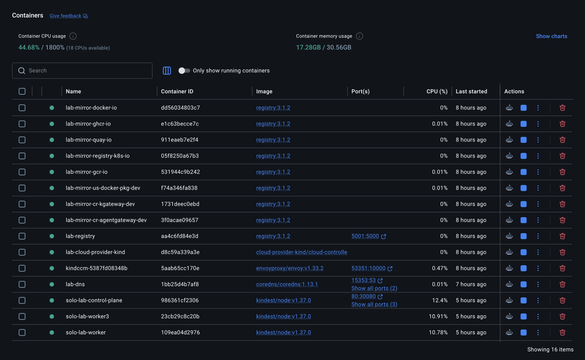

# Setup and reference

Everything the [README](../README.md) leaves out: requirements in full,
machine setup, accounts, configuration, every `make` target, and how the
repository is laid out.

## Requirements

- macOS, Linux or Windows with WSL2 (developed on macOS on Apple silicon;
  x86_64 and arm64 images throughout)
- Docker Desktop, OrbStack or Colima on macOS, or Docker Engine with buildx
  on Linux, with 24 GB or more for Docker (`make preflight` refuses under
  16 GB; the full lab uses about 17 GB)
- kind v0.32 or newer, kubectl, helm, jq, [yq v4](https://github.com/mikefarah/yq),
  envsubst (gettext), openssl, python3, git, curl
  - macOS: `brew install kind kubectl helm jq yq gettext openssl`
  - Debian/Ubuntu: `sudo apt-get install jq gettext-base openssl python3 git curl docker-buildx-plugin libnss3-tools`,
    then kind, kubectl, helm and yq from their release pages
  - Fedora: `sudo dnf install jq gettext openssl python3 git curl nss-tools`, same for the rest
- Ports 80 and 443 free on 127.0.0.1, or set `LAB_HTTP_PORT`/`LAB_HTTPS_PORT` in `.env`
- A model: [Ollama](https://ollama.com) on the host (`ollama pull qwen3.8:27b`),
  or an Anthropic or OpenAI key

`make preflight` checks all of this, and `make up` runs it first. On a
Docker VM (Docker Desktop, OrbStack, Colima) it also raises the inotify
limits inside the VM, which reset whenever the VM restarts. With Docker
Engine they are the host's own, and preflight says what to run if they're
too low.

## Machine setup

`make machine-setup` (once per machine, sudo) makes `*.lab` resolve to
127.0.0.1 and trusts the lab CA. On macOS it uses `/etc/resolver` and the
System keychain. On Linux it uses systemd-resolved (or a marked block in
`/etc/hosts`), the distro's trust store and the NSS databases Chrome and
Firefox read. On WSL2 it sets up the distro and prints the two commands for
a browser on Windows.

Story 2 builds Alice's and Meridian's services from
[uma4agents](https://github.com/nickgamb/uma4agents), using a checkout beside
this repo (`../uma4agents`) or at `U4A_SRC`. Without one, the install clones
the pinned commit into `.lab/uma4agents`.

## What runs in Docker

`make up` is idempotent. Image caches and the lab CA outlive the cluster, so
a rebuild after `make down` is much faster than the first. It leaves running:

- pull-through mirrors for each upstream registry (`lab-mirror-*`)
- a push registry for lab-built images (`lab-registry`, `localhost:5001`
  unless `LAB_REGISTRY_PORT` says otherwise)
- `lab-dns`, answering `*.lab` on port 15353
- `cloud-provider-kind`
- the kind nodes: one control plane and three workers, in zones a, b and c



**Updating an existing lab.** After pulling, `make platform` re-applies every
layer and demo. A lab from before S&V's own Keycloak needs at least
`make layer-45 layer-47 layer-95` (the `workforce` realm, and the chain
ending in `break-glass`).

## Accounts

S&V's employees live at its IdPs; the broker gets an account for each from
the primary.

| Account | Password | Who |
| --- | --- | --- |
| `bob` | `bob-demo`, then `make totp` | an advisor (group `advisors`) |
| `carol` | `carol-demo`, then `make totp EMPLOYEE=carol` | another S&V employee |
| `dana` | `dana-demo`, then `make totp EMPLOYEE=dana` | a platform engineer (`platform-engineers`): an admin in the Solo UI |
| `ops` | `ops-demo` | realm `ops` for the Observatory, Grafana and Kiali; S&V's break-glass platform admin at the broker, the only sign-in when every IdP is down |
| `alice` | `alice-demo` | Alice, in her own realm |

Those passwords and one-time codes are S&V's own Keycloak's. At Auth0 the
passwords are the ones you set ([IDPS.md](IDPS.md#auth0-auth0)). The
`export_book` tool needs S&V's `compliance` group, which has no users. To try
it, add one to `compliance` at the broker (realm `sterling-vance`).

Generated secrets (Keycloak admin passwords, client secrets) are in
`.lab/secrets.env`, created on first install and gitignored. Keycloak's
admin consoles are off the edge; reach them with a port-forward
([COMMANDS.md](COMMANDS.md#identity)).

## Configuration

`.env` (copy `.env.example`, gitignored) holds everything personal:

| Key | Used for |
| --- | --- |
| `LLM_PROVIDER` | `ollama` (default), `anthropic` or `openai`; apply with `make llm` |
| `LLM_FALLBACK`, `LLM_FALLBACK_MODEL` | a second provider (and model) the gateway fails over to; apply with `make llm` |
| `OLLAMA_MODEL`, `OLLAMA_URL` | the local model and where the cluster reaches it |
| `ANTHROPIC_API_KEY`, `ANTHROPIC_MODEL`, `OPENAI_API_KEY`, `OPENAI_MODEL` | hosted models (held by agentgateway only) |
| `ENTERPRISE_IDP` | S&V's IdPs, who sign Bob in, by name in failover order (default `auth0,keycloak,contingency`). An IdP without an issuer is left out, so a fresh clone starts on S&V's own Keycloak ([IDPS.md](IDPS.md)) |
| `<NAME>_ISSUER`, `<NAME>_CLIENT_ID`, `<NAME>_CLIENT_SECRET` | each IdP in the chain (`auth0`, `gluu`, `okta`, `ping`, any other); without a secret S&V authenticates with its keys (`make xaa-keys`). `keycloak` and `contingency` default to S&V's own at `login.sterling.lab` and `login-dr.sterling.lab` |
| `<NAME>_DIRECTORY_*`, `<NAME>_GROUPS_CLAIM`, `<NAME>_ASSURANCE`, ... | the rest of an IdP's settings ([IDPS.md](IDPS.md#settings)) |
| `RESOURCE_AS`, `LEDGERLINE_<NAME>_ISSUER`, `LEDGERLINE_<NAME>_CLIENT_ID` | Ledgerline's authorization server, by name: `keycloak` (default, its own) or any other ([IDPS.md](IDPS.md#ledgerlines-authorization-server)) |
| `config/continuity.local.yaml` | this lab's own S&V profile attributes and IdP mappings, kept across rebuilds (format: `config/continuity.example.yaml`) |
| `EDITION`, `<PRODUCT>_EDITION`, `SOLO_LICENSE_KEY` | Solo Enterprise, all products or one at a time ([ENTERPRISE.md](ENTERPRISE.md)) |
| `SOLO_<PRODUCT>_LICENSE_KEY` | a licence for one product, in place of `SOLO_LICENSE_KEY` |
| `LAB_PASSWORD_GRANT` | (`config/lab.env`) the password grant on Alice's portal client |
| `LAB_TLD`, `LAB_LISTEN_ADDRESS`, `LAB_CERT_ISSUER`, `SV_MAIL_DOMAIN` | (`config/lab.env`) the lab under public names with Let's Encrypt certificates, as on AWS ([AWS.md](AWS.md)) |
| `AWS_*` | the lab on one EC2 instance: `make aws-up` ([AWS.md](AWS.md)) |

`config/lab.env` holds the lab's shape: cluster name, node image, worker
count, host ports, party domains, registry port; `config/oss.env` and
`config/enterprise.env` pin every version. Any of them can be overridden in
`.env`, and the command line wins over both (`make llm LLM_PROVIDER=anthropic`,
`KAGENT_VERSION=... make layer-60`).

## Make targets

| Target | Does |
| --- | --- |
| `machine-setup` | once per machine, sudo: `*.lab` DNS and trust in the lab CA (macOS, Linux, WSL2) |
| `up` | `cluster` then `platform` |
| `cluster` | kind cluster, registry caches, cloud-provider-kind, lab DNS |
| `platform` | every layer under `platform/` in order |
| `layer-NN` | one layer, e.g. `make layer-90` (Observatory) |
| `verify` | `reset`, then `bob-verify`, `alice-verify`, `continuity-verify`, `observatory-verify` |
| `bob-verify` | story 1 checks only (delegation, per-tool policy, Cross App Access, assurance rules) |
| `alice-verify` | story 2 checks only (Bob to Alice, UMA for agents), after a `reset` |
| `continuity-verify` | identity continuity checks only (failover, kill switch, live rules, routing, directory sync) |
| `observatory-verify` | what the Observatory's admins may and may not change (RBAC, admission) |
| `tour` | drive every story end to end, paced, to watch in the Observatory |
| `reset` | rewind the demos (grants, terms, agent key, follow-ups, relationships) |
| `llm` | switch the model: `make llm LLM_PROVIDER=anthropic` |
| `totp` | a one-time code for S&V's own Keycloak: `make totp` (Bob), `make totp EMPLOYEE=dana` |
| `xaa-logs` | the Cross App Access trail (both token requests, claims, checks), tokens redacted: `make xaa-logs SINCE=2h` |
| `routes` | where sign-ins go now: each routing rule's IdP, and where a browser app, an AI client and an AI client for Ledgerline land |
| `xaa-keys` | the public keys other parties register, in `.lab/xaa/keys/`: S&V's clients at upstream IdPs and at Ledgerline, S&V's broker (`sv-idp.jwks.json`, for an AS outside the lab), Ledgerline's SSO client at S&V's broker |
| `upstream-mcp` | an outside MCP server at the front door, signed in at its own authorization server (Enterprise): `make upstream-mcp NAME=x URL=https://… AS=https://… SCOPES="a b"`; `upstream-mcp-remove NAME=x` removes it ([IDENTITY-FLOWS.md](IDENTITY-FLOWS.md)) |
| `status` | pods, the active IdP, URLs |
| `preflight` | tools, Docker resources, free ports, `*.lab` DNS, Ollama and its model |
| `help` | every target, with its one-line description |
| `down` | delete the cluster (keeps caches and the CA) |
| `nuke` | delete the cluster and every `lab-*` container and volume: registry caches, the local registry with every image built into it, lab DNS (`make up` recreates them) |
| `aws-up`, `aws-sync`, `aws-run-<target>`, `aws-ssh`, `aws-stop`, `aws-start`, `aws-status`, `aws-down` | the lab on one EC2 instance under public names ([AWS.md](AWS.md)) |

## Layout

```
config/          lab shape (lab.env) and edition pins (oss.env, enterprise.env)
cluster/         kind config template
scripts/         cluster lifecycle, DNS, CA, machine setup, preflight, helpers (lib.sh),
                 status, reset, llm, tour, outside MCP servers (upstream-mcp.sh),
                 the lab on AWS (aws.sh)
platform/NN-*/   one install.sh per layer, applied in order by make platform
demos/           each story: install.sh, verify.sh, manifests, agents, tools
apps/observatory Observatory: Go server (server/) and React UI (web/)
apps/continuity  IdentityContinuity, WorkloadProfile, RelationshipModel and Relationship
                 CRDs, controller, directory sync, the assurance rules (Rego) and gate
apps/relationship-guard
                 the gateway's entitlements check (OpenFGA), an MCP guardrail
apps/idtoken-exchange
                 Cross App Access at S&V's egress: the user's ID token from S&V's broker
tools/           patched upstream builds (kagent, Substrate, Keycloak), the probe
                 toolbox image and mcp-probe.py, diagram generators
docs/            architecture, per-app docs, commands, demo cards, images and videos
```

| Layer | Installs |
| --- | --- |
| `00-foundation` | Gateway API, metrics-server, cert-manager, trust-manager, lab CA, namespaces, CoreDNS `*.lab` → edge |
| `10-istio` | Istio ambient: base, istiod, istio-cni, ztunnel |
| `20-observability` | kube-prometheus-stack, Tempo, OTel collector, Kiali |
| `30-kgateway` | the edge: per-party TLS listeners on NodePorts 30080/30443 |
| `40-agentgateway` | ai-gateway: LLM backend, MCP; on Enterprise the STS for MCP servers' tokens and Solo's ext-auth service, replicated |
| `45-identity` | S&V's mesh baseline, S&V's broker (Keycloak, `idp.sterling.lab`), S&V's own Keycloak (`login.sterling.lab`, realm `workforce`), its contingency IdP (`login-dr.sterling.lab`), client secrets for S&V components |
| `47-continuity` | IdentityContinuity and WorkloadProfile CRDs and controller, the directory sync, the assurance rules (Solo's ext-auth service on Enterprise, the assurance gate on OSS), S&V egress waypoint |
| `48-relationships` | OpenFGA (3 replicas) on Postgres (CloudNativePG, 3 instances) in `sv-authz`, S&V's relationship model |
| `50-substrate` | Agent Substrate (patched), in the mesh |
| `60-kagent` | kagent + kmcp (patched), ops agents on Substrate, their tools (kagent-tools, its own release) behind ai-gateway, edge SSO (OSS) |
| `70-agentregistry` | agentregistry behind S&V SSO |
| `80-mesh-policy` | S&V's mesh baseline, re-applied, STRICT mTLS mesh-wide, and S&V's egress fences |
| `90-observatory` | Observatory, its Keycloak (realm `ops`), Grafana and Kiali on the edge behind it, the Solo UI on Enterprise, gateway access logs |
| `95-demos` | every story: `demos/bob`, then `demos/bob-to-alice` |
